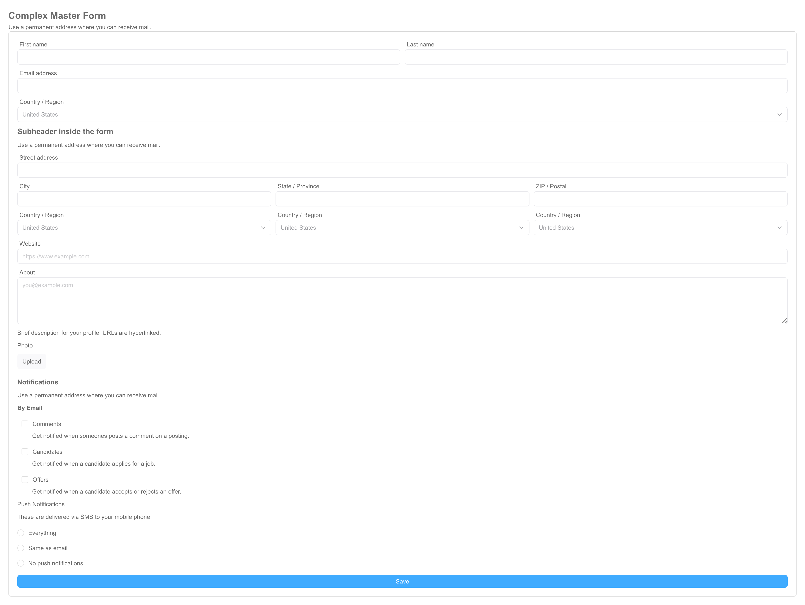
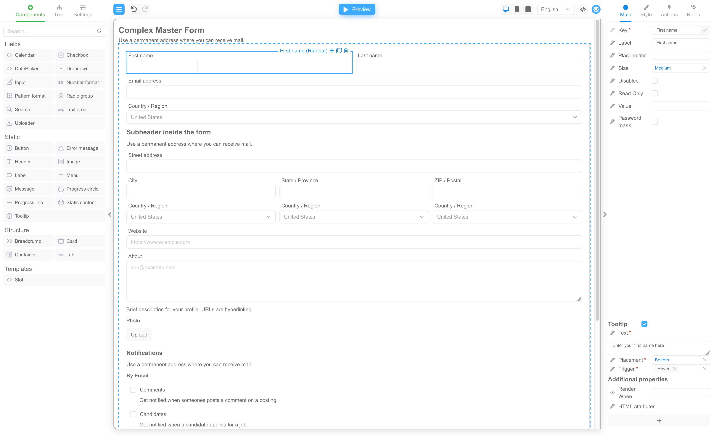

# Optimajet FormEngine Community and FormEngine Premium repository

## Overview

This repository contains two products in the **FormEngine** suite.

**FormEngine Community**
A free,
open-source solution for building forms in React with code that is straightforward—even for developers who are not front-end specialists.
Similar to React Hook Form, it lowers the entry barrier for creating complex React forms while offering more features out of the box,
including event handling, computed fields, validation, localization, and a ready-to-use component library.

**FormEngine Premium**
A commercial drag-and-drop form builder for React that includes everything in **FormEngine Community**,
plus an embeddable visual form editor and a set of business-specific components.
Build front-end forms visually to cut costs and speed up development.

## Key Features

These features apply to both products.

- **UI-Agnostic Components:** Works seamlessly with any UI
  library ([MUI](https://mui.com/), [Ant Design](https://ant.design/), [shadcn/ui](https://ui.shadcn.com/)
  and [others](https://formengine.io/documentation/custom-components))
- **Pre-Built React Suite Integration:** Includes a ready-to-use component
  library – [@react-form-builder/components-rsuite](https://www.npmjs.com/package/@react-form-builder/components-rsuite).
- Framework Support:
  - **Next.js Integration**: Seamlessly works with [Next.js](https://formengine.io/documentation/usage-with-nextjs).
  - **Remix Compatibility**: Fully supports [Remix](https://formengine.io/documentation/usage-with-remix).
  - **Framework-Agnostic**: Can also be used [without any framework](https://formengine.io/documentation/installation#cdn) via CDN.
- **Multi-Database Support:** Compatible with MySQL, PostgreSQL, MongoDB, SQLite, and more.
- **Built-in Validation with Zod:** Includes pre-configured validation rules powered by [Zod](https://github.com/colinhacks/zod).
- **Extensible Validation Support:** Works
  with [Yup](https://github.com/jquense/yup), [AJV](https://github.com/ajv-validator/ajv), [Zod](https://github.com/colinhacks/zod),
  [Superstruct](https://github.com/ianstormtaylor/superstruct),
  [Joi](https://github.com/hapijs/joi), and other custom validation libraries.
- **Responsive Layouts**: Build forms that automatically [adapt](https://formengine.io/documentation/adaptive-layout) to all screen sizes.
- **Custom Actions**: Enhance forms with interactive logic through [custom JavaScript code](https://formengine.io/documentation/actions).
- **Dynamic Properties**: Implement real-time component changes with [MobX](https://github.com/mobxjs/mobx)-powered reactive properties.
- **Flexible Storage Options**:
  - Store complete form definitions as JSON.
  - Programmatically generate forms [via code](https://formengine.io/documentation/building-forms-via-code).

## Documentation

[Documentation website](https://formengine.io/documentation)

## Repository structure

- **community**: source code and examples for **FormEngine Community** product (MIT license).
- **premium**: examples for **FormEngine Premium** product (commercial license).

## Screenshots

### Form Engine Community

### Form Engine Premium

## Information

- Website: [formengine.io](https://formengine.io).
- Demo: [demo.formengine.io](https://demo.formengine.io).
- Documentation: [formengine.io/documentation](https://formengine.io/documentation).

For FormEngine Premium inquiries, please contact [sales@optimajet.com](mailto:sales@optimajet.com).
