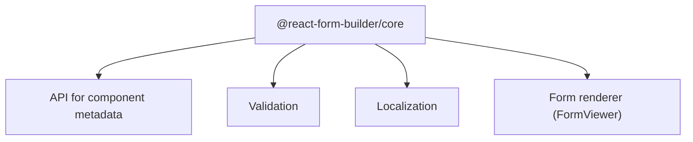
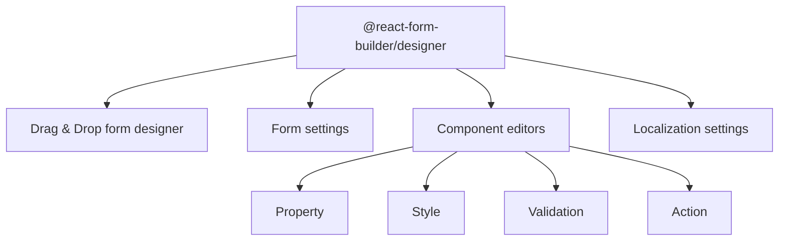
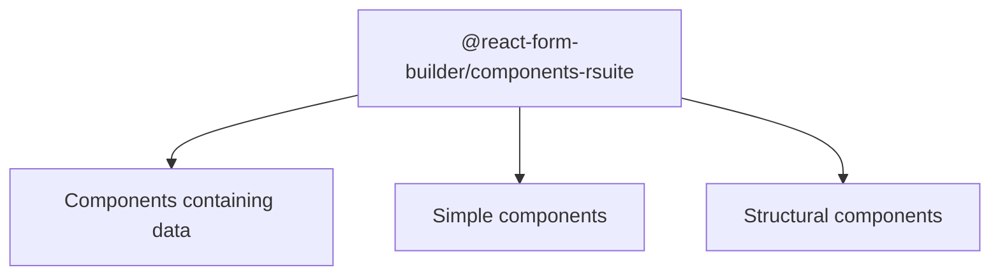

## FormEngine Designer for developers - Packages and architecture

:::info For form authors

If you design forms in the UI without writing code, use the [Form Author Guide](designer-guide:) instead of this page.

:::

This page describes **npm packages**, dependencies, and a **step-by-step demo tutorial** with custom action code. For installation and React embedding, continue to [Installation](/formengine-designer/getting-started/installation) and [Usage](/formengine-designer/getting-started/usage).

## NPM packages

Form Builder consists of the following NPM packages:

1. [@react-form-builder/core](https://www.npmjs.com/package/@react-form-builder/core).
2. [@react-form-builder/designer](https://www.npmjs.com/package/@react-form-builder/designer).
3. [@react-form-builder/components-rsuite](https://www.npmjs.com/package/@react-form-builder/components-rsuite).
4. [@react-form-builder/components-fast-qr](https://www.npmjs.com/package/@react-form-builder/components-fast-qr).
5. [@react-form-builder/components-rich-text](https://www.npmjs.com/package/@react-form-builder/components-rich-text).

:::tip

Form Builder packages rely on peer dependencies. Make sure your package manager automatically installs peer dependencies.

:::

## @react-form-builder/core package

This is the main Form Builder package that contains the React methods and components for displaying the form. This package must be used at runtime.



## @react-form-builder/designer package

This is a package containing a visual form designer. This package is only needed for designing forms; it is not needed for displaying forms.



## @react-form-builder/components-rsuite package

This package contains components and metadata from the [React Suite](https://rsuitejs.com/) library. You may use another component library instead.



## @react-form-builder/components-fast-qr

QR code component based on [Fast QR](https://www.npmjs.com/package/fast_qr).

## @react-form-builder/components-rich-text

Rich text editor component based on [Quill](https://quilljs.com/).

## GitHub example

Clone the [FormEngine GitHub](https://github.com/optimajet/formengine) repository and follow the README. The example combines core, designer, and RSuite components.

## Detailed demo tutorial (RSuite) {#detailed-demo-tutorial-rsuite}

The walkthrough below uses the public demo at [https://demo.formengine.io/](https://demo.formengine.io/) with RSuite-oriented labels. For a
**Material UI**–oriented author path without code, use the [Form Author Guide](designer-guide:your-first-form/create-your-first-form/).

### Workspace layout


The screen is divided into three parts:

1. **Left** - **Tree**, **Components**, **Settings**, **Forms**
2. **Center** - menu, undo/redo, Preview/Edit, device modes, language, JSON view, theme
3. **Right** - **Main**, **Style**, **Actions**, **Rules**

### Create a form (demo)


Add **Input** and **Button** components, set **Key** `name` and label **Name**, set button **Content** to **Submit** (`getting-started-06`–`09`).

### Validation and actions (code)

Add **Required** and **Min** rules on the input (`getting-started-10`–`11`). Add a custom **onClick** action on the button (`getting-started-12`–`14`):

```javascript
/**
 * @param {ActionEventArgs} e - the action arguments.
 * @param {} args - the action parameters arguments.
 */
async function Action(e, args) {
  console.log('Name', e.data.name)
}
```

- [ActionEventArgs](/api-reference/@react-form-builder/core/classes/ActionEventArgs) `e` contains event data.
- [Record&lt;string, unknown&gt;](/api-reference/@react-form-builder/core/classes/ActionEventArgs#data) `e.data` is the form data object.

Read and write fields with `e.data.name`. Example mutation:

```javascript
async function Action(e, args) {
  console.log('Name', e.data.name)
  e.data.name = `Marta ${new Date().getTime()}`
}
```

### Preview and validate action order

Use **Preview**, then add **validate** before the custom action (`getting-started-15`–`17`). Adjust **Error type** and **Tooltip type** on **Settings** (`getting-started-18`–`21`).

Authors: see [Action order on buttons](designer-guide:behavior-and-validation/action-order-on-buttons/) and
[Form-wide errors and tooltips](designer-guide:appearance-and-readability/form-wide-errors-and-tooltips/).

---

## Summary

- **core** renders forms; **designer** is the visual editor; component packages supply widgets.
- Authors should use the [Form Author Guide](designer-guide:); integrators use installation, usage, and this page.

## Next steps

- [Installation](/formengine-designer/getting-started/installation)
- [Usage](/formengine-designer/getting-started/usage)
- [Form Author Guide](designer-guide:)
