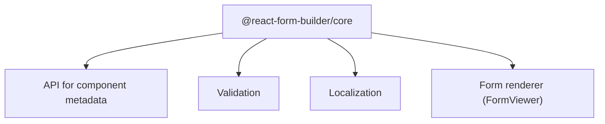
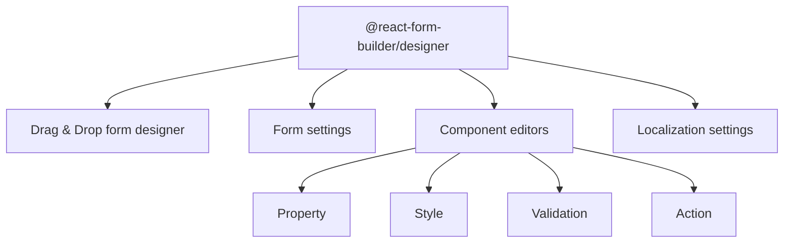
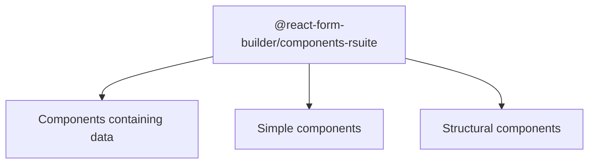

# Overview

Form Builder consists of the following NPM packages:

1. [@react-form-builder/core](https://www.npmjs.com/package/@react-form-builder/core).
2. [@react-form-builder/designer](https://www.npmjs.com/package/@react-form-builder/designer).
3. [@react-form-builder/components-rsuite](https://www.npmjs.com/package/@react-form-builder/components-rsuite).

:::tip

Form Builder packages rely on peer dependencies, make sure your package manager automatically installs peer dependencies.

:::

## @react-form-builder/core package

This is the main Form Builder package that contains the React methods and components for displaying the form. This package must be used at
runtime.



## @react-form-builder/designer package

This is a package containing a visual form designer. This package is only needed for designing forms, it is not needed for displaying forms.



## @react-form-builder/components-rsuite package

This package contains components and metadata for components from the [React Suite](https://rsuitejs.com/) library. You may or may not use
it. You can plug in your favorite component library and use that instead.



## Example

Clone our [GitHub](https://github.com/optimajet/formengine) repository with the example and follow the instructions to run it. The example
on GitHub combines all three libraries:

1. [@react-form-builder/core](https://www.npmjs.com/package/@react-form-builder/core).
2. [@react-form-builder/designer](https://www.npmjs.com/package/@react-form-builder/designer).
3. [@react-form-builder/components-rsuite](https://www.npmjs.com/package/@react-form-builder/components-rsuite).

## Creating a simple form

Open your browser at our demo page - https://demo.formengine.io/.

You will see the following screen:


The screen divided to three parts:

1. Left side with tabs:
  - Tree - on this tab, you can see the tree of components that make up the form.
  - Components - on this tab you can see the list of components available for use.
  - Settings - this tab displays the form settings.
  - Forms - this tab displays the list of forms.
2. Centre part of the screen:
  - Menu button.
  - Undo/Redo buttons.
  - Toggle Preview/Edit button.
  - Adaptive mode toggle buttons.
  - Control to select the current form language.
  - Button to show JSON of the form.
  - Dark/light theme switch.
3. Right side with tabs:
  - Main - on this tab you can edit the properties of the selected component.
  - Style - on this tab you can edit the styles of the selected component.
  - Actions - on this tab you can edit the actions of the selected component.
  - Rules - on this tab you can edit the rules of validation of the selected component value.

Go to the **Forms** tab and click on the **Add New Form** button:


Enter the name of the form and click the **OK** button:


The new form has been created and appears in the list of forms on the left. Click on the pencil icon to start editing the new form:


You should now see an empty form:


Now let's add some components to the form. Switch to the Components tab and drag and drop the "Input" and "Button" components:


Now let's give the name "name" to the "Input" component. And set the button label to "Submit".

First, select the "Input" component by clicking on it on the form. In the right pane of the "Main" tab, enter "name" in the "Key" property
and click the "&#10003;" button.


Then in the "Label" property, type in the value "Name" as well.


Now select the button on the form and in the "Content" property, type in the value "Submit".


We have one input field and one button - let's add validation on the value for the input field, and when the button is clicked it will write
the form data to the console.

Select the input fields in the center portion of the form, and then switch to the "Rules" tab.


Now click on the "Add rule" button and select "Required" from the drop-down list. Click the "Add rule" button again and select "Min" from
the drop-down list. In the "Limit" field for the "Min" rule, set the value to "3".

In this way we have added two value validation rules - the first rule requires the field to be populated, the second rule requires the field
value to have a minimum of three characters.

The "Auto validate" checkbox means that the field value will be automatically validated while entering the value into the field.

Note that we have not filled in the "Message" fields, so we will get a built-in error message for this validator.


Validation added. Now let's add an event handler for the button. To do this, select the button in the central part of the form and go to
the "Actions" tab.


Validation added. Now let's add an event handler for the button. To do this, select the button in the central part of the form and go to
the "Actions" tab. Click on the "Add action" button after "onClick", select "Custom" => "Add custom action" in the dropdown menu.


The action code editor appears at the bottom of the screen. Enter the action name and code as in the screenshot below, then click the "Save"
button.


This is our simplest action:

```javascript
/**
 * @param {ActionEventArgs} e - the action arguments.
 * @param {} args - the action arguments.
 */
async function Action(e, args) {
  console.log('Name', e.data.name)
}
```

- [ActionEventArgs](/api-reference/classes/react_form_builder_core.ActionEventArgs) `e` is a variable containing the event data.
- [Record<string, unknown>](/api-reference/classes/react_form_builder_core.ActionEventArgs#data) `e.data` is the data of the form.

:::info

Using the `e.data` object, you can read and write form data, as in this example. We have a form input component with the `name` key. We can
use the following code to read the value: `e.data.name`. To write the value, we can use the following code: `e.data.name = 'Some value'`.

:::

Change the action code to the following to see how you can change the data in the form using the action:

```javascript
/**
 * @param {ActionEventArgs} e - the action arguments.
 * @param {} args - the action arguments.
 */
async function Action(e, args) {
  console.log('Name', e.data.name)
  // highlight-next-line
  e.data.name = `Marta ${new Date().getTime()}`
}
```

## Testing the created form

It's time to test our form in action. To do this, click the big "Preview" button - the button change its label to "Edit" - which means that
we are now in the form preview mode.

Try entering different values in the input box and click the "Submit" button to see the value of the form in the console.


Now we want validation to occur before the data is output to the console. Well, there is a built-in "validate" action to validate the form,
let's use it.

Go to the form edit mode by clicking "Edit" button, select the button in the center of the screen, and then go to the "Actions" tab.


Click on the "Add action" button located after our "logValue" action, select "Common" => "validate". Then simply drag the "validate" action
in front of the "logValue" action.


And let's make our error message a little more sympathetic. To do this, go to the "Settings" tab on the left side of the screen and select
"Rs Error Message" in the "Error type" field.


And let's also select a component on this tab that will display tooltips. To do this, select the "Rs Tooltip" value in the "Tooltip type"
field.


Since we have selected a component that can display tooltips, we have a "Tooltip" section in the right-hand properties panel of the
component where we can configure a tooltip for each component. Let's add a tooltip for the button.

Select the button in the center pane, and in the right pane, select the "Main" section. Click the checkbox next to "Tooltip" and enter the
tooltip text in the "Text" field, as in the screen below.


Switch to form view and hover over the form, you should see something like the screenshot below. Note that the error message is now
displayed differently.


## Conclusion

In this section, we created a simple form, added an onClick event handler for the form, and added validation on the input field. We also
added a tooltip for the button and changed the format of the error message display.
