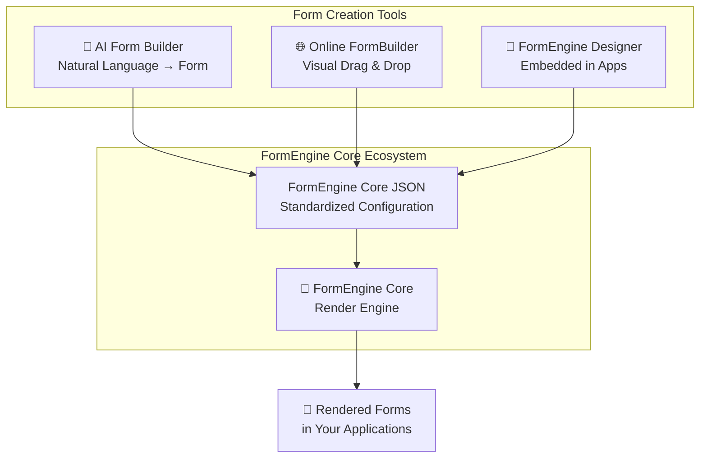

# FormEngine Documentation - React Form Builder Guide

FormEngine is a comprehensive suite of products that enables you to create, manage, and deploy online forms with unprecedented ease and
flexibility. The platform offers solutions for every stage of form development—from visual building tools to powerful rendering engines and
AI-assisted creation.

## Product Ecosystem

### 🎯 FormEngine Core

**Open-Source, free JSON form renderer React library**

FormEngine Core is a lightweight, high-performance React library that renders forms from JSON configuration. It handles all form state
management, validation, event handling, and conditional logic while letting you use any React component library you prefer: Material UI,
React Suite, Chakra UI, Ant Design, or your own design system.

With FormEngine Core, you can:

- Render forms from JSON with real-time state management
- Use built-in validation powered by Zod, with custom rule support
- Add multi-language and localization support
- Create dynamic forms with conditional rendering
- Extend the component system with TypeScript support
- Work with any React component library

### 🎨 FormEngine Designer

[**React drag and drop form builder library**](/formengine-designer)

FormEngine Designer is a visual form building tool that you can embed directly into your applications. It provides a drag-and-drop interface
where users can create forms without writing any code. The designer generates JSON configuration that FormEngine Core renders, giving you a
seamless workflow from visual design to functional forms.

With FormEngine Designer, you get:

- A visual drag-and-drop form builder interface
- Real-time preview of form designs
- Export to FormEngine Core JSON format
- A component palette with search and filtering
- Property editors for component customization
- Easy integration with existing React applications

### 🌐 Online FormBuilder

**[Create forms for FormEngine Core Online](https://formbuilder.formengine.io/)**

Online FormBuilder is a cloud-based version of FormEngine Designer that requires no installation or setup. It's a complete web
application where you can design forms visually and instantly generate JSON configuration for FormEngine Core. Use it for quick prototyping,
sharing form designs with your team, or when you prefer a SaaS solution.

With Online FormBuilder, you can:

- Use a zero-installation web application
- Save form designs in the browser database
- Collaborate with team workflows
- Export JSON for FormEngine Core with one click
- Start from pre-built templates and examples
- Preview responsive designs across device sizes

### 🤖 AI React Form Builder

**[Build a complex form with AI, drop it into GPT](https://formengine.io/ai-form-builder/)**

AI React Form Builder uses artificial intelligence to generate forms from natural language descriptions. Describe what you need in plain
English, and the AI creates a complete form with appropriate fields, validation, and layout. The generated forms are compatible with
FormEngine Core, giving you a powerful synergy between AI-assisted creation and a robust rendering engine.

With AI React Form Builder, you can:

- Generate forms from natural language
- Get AI-powered field selection and validation
- Receive context-aware layout suggestions
- Export to FormEngine Core JSON format
- Integrate with GPT and other AI models
- Refine forms iteratively based on feedback

## How Products Work Together

The FormEngine ecosystem is designed as interconnected components that work seamlessly together:

**Workflow Explanation:**

1. **Creation**: Forms can be created through multiple entry points:
   - **AI FormBuilder**: Describe forms in natural language
   - **Online FormBuilder**: Use the cloud-based visual designer
   - **FormEngine Designer**: Embed the designer in your applications
2. **Output**: All creation methods produce **FormEngine Core JSON** - a standardized format that describes the form structure, logic, and
   behavior.
3. **Rendering**: FormEngine Core takes the JSON configuration and renders it as a fully functional form using your chosen component
   library.
4. **Integration**: FormEngine Designer can be embedded directly into React applications, allowing end-users to create forms within your
   application interface.

## FormEngine Core Documentation Structure

The FormEngine Core documentation is organized into three complexity levels so you can quickly find what you need. This structure helps you
learn at your own pace and discover advanced features when you need them.

###  Essential {#essential}

**Critical knowledge for daily use**

Start with the essential topics. These sections cover the fundamentals you'll use in 80% of your form-building work. We recommend reading
these first to get the most out of FormEngine Core.

Essential documentation includes:

- **[Installation](/formengine-core/installation)** – Get FormEngine Core up and running in under 5 minutes
- **[Rendering Forms](/formengine-core/rendering-forms)** – Learn how FormEngine Core renders forms from JSON
- **[Handling Form Data](/formengine-core/handling-form-data)** – Work with form data from basic binding to advanced manipulation
- **[Validation](/formengine-core/validation)** – Comprehensive guide to form validation in FormEngine Core

###  Additional {#additional}

**Useful extensions and best practices**

Explore these sections when you're ready to enhance your forms. They include optimization techniques, styling options, and integration
patterns that improve both your development experience and your forms' performance.

Additional documentation includes:

- **[Conditional Rendering](/formengine-core/conditional-rendering)** – Show or hide components based on form state
- **[Actions and Events](/formengine-core/actions-and-events)** – Create interactive forms with event handling
- **[Localization](/formengine-core/localization)** – Build multi-language forms for international audiences
- **[Tooltip](/formengine-core/tooltip)** – Add contextual help to form fields
- **[Styling Components and Forms](/formengine-core/styling-components-and-forms)** – Customize appearance with CSS, JSON, and responsive
  design
- **[Disabled and Read-Only Components](/formengine-core/disabled-and-read-only)** – Control component interaction states
- **[Components Library](/components-library)** – Explore available components
- **[Layout System](/formengine-core/adaptive-layout)** – Understand form layout mechanisms

###  Advanced {#advanced}

**Specialized features for complex scenarios**

Reference these topics when you face advanced requirements or need to customize FormEngine Core deeply. These features give you maximum
control for complex use cases.

Advanced documentation includes:

- **[Form JSON](/formengine-core/forms-json)** – Deep dive into the shared structure of FormEngine form JSON
- **[Computed Properties](/formengine-core/computed-properties)** – Create dynamic form properties
- **[User Defined Properties](/formengine-core/user-defined-properties)** – Extend forms with custom properties
- **[HTML Attributes](/formengine-core/html-attributes)** – Work with HTML attributes
- **[Embedded Forms](/formengine-core/embedded-forms)** – Nest forms within forms
- **[Modal](/formengine-core/modal)** – Implement modal dialogs
- **[JSON Schema](/formengine-core/json-schema)** – Understand the JSON schema for forms
- **[Custom Components](/formengine-core/custom-components)** – Extend FormEngine Core with your own components

## Color Coding in FormEngine Core Documentation

Look for the color coding in the left navigation panel of the FormEngine Core documentation. Each color tells you at a glance what kind of
content you'll find:

-  Start here for essential knowledge
-  Explore these for useful extensions
-  Reference these for advanced scenarios

This visual system helps you find the right information quickly, whether you're just starting out or tackling a complex challenge.

---

## Ready to Build Amazing Forms?

Choose your path based on what you want to accomplish:

### For Developers Integrating Forms

Start with the **[FormEngine Core documentation](/formengine-core)** to learn how to render forms from JSON in your React applications.
You'll discover how to work with any component library while getting built-in validation, state management, and multi-language support.

### For Building Form Creation Tools

Explore **[FormEngine Designer](/formengine-designer)** to add visual form building capabilities to your applications. Give your users a
drag-and-drop interface to create forms without writing code.

### For Quick Form Prototyping

Try the **[Online FormBuilder](https://formbuilder.formengine.io/)** when you need to design forms fast. No installation required—just
create, export JSON, and integrate with FormEngine Core.

### For AI-Assisted Development

Experiment with the **[AI React Form Builder](https://formengine.io/ai-form-builder/)** to generate forms from natural language
descriptions. Describe what you need, and let AI handle the details.

Whichever path you choose, all roads lead to **FormEngine Core JSON**—the universal format that powers the entire ecosystem. This
consistency ensures your forms work seamlessly across all FormEngine products.

**Your first form is just minutes away.** Pick your starting point and begin creating!
