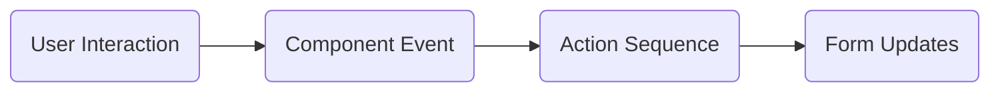

# Form Events & Actions - Handle User Interactions

Actions and events are the core building blocks for creating interactive forms in FormEngine Core. They allow you to define what happens
when users interact with your forms: clicking buttons, typing text, selecting options, and more.

In this guide, you'll learn:

- What events and actions are in FormEngine Core
- How events and actions work together
- How to bind actions to events, including the correct syntax for code actions
- The order in which actions execute
- Practical examples from simple to complex

## Understanding the Basics

### What Are Events?

An **event** is something that happens in your form when a user interacts with a component. Common examples include:

- Clicking a button (`onClick`)
- Typing in a text field (`onChange`)
- Moving focus to or from a field (`onFocus`, `onBlur`)

Events are triggered by user interactions and form state changes. Each component can define its own set of events through its properties.

### What Are Actions?

An **action** is a piece of code that runs in response to an event. Actions can:

- Validate form data
- Save data to a server
- Show or hide form sections
- Calculate values
- Navigate to another page
- Execute any custom logic you need

Actions are organized into sequences that execute one after another when an event occurs.

### How Events and Actions Relate

Think of events as triggers and actions as responses:




When a user interacts with a component (like clicking a button), the component fires an event. FormEngine Core captures this event and
executes all actions bound to it, in the order they were defined.

## Action Types in FormEngine Core

There are three types of actions you can use in FormEngine Core:

### 1. Common Actions

Built-in actions that provide common functionality like validation, logging, and form state management. These are always available without
any additional configuration.

### 2. Code Actions

Inline JavaScript code that you define directly in your form JSON. These actions are executed in the form's context and have access to form
data and state.

### 3. Custom Actions

Functions you define in your application code and pass to the FormViewer component. These allow you to integrate with your backend, perform
complex calculations, or execute any custom logic.

## Binding Actions to Events

Actions are bound to events using [JSON configuration](/api-reference/@react-form-builder/core/classes/ComponentStore#events) in your form
definition. Each event can have multiple actions that execute in sequence.

### Basic Structure

```json
{
  "key": "submitButton",
  "type": "MuiButton",
  "props": {
    "children": {
      "value": "Submit"
    }
  },
  "events": {
    "onClick": [
      {
        "name": "validate",
        "type": "common"
      },
      {
        "name": "log",
        "type": "common"
      },
      {
        "name": "submitForm",
        "type": "custom"
      }
    ]
  }
}
```

In this example, when the button is clicked:

1. The `validate` common action runs (checks form validation)
2. The `log` common action runs (logs to console)
3. The `submitForm` custom action runs (your custom logic defined in application code)

### Action Definition Format

Each action in the sequence has this [structure](/api-reference/@react-form-builder/core/type-aliases/ActionData):

```json
{
  "name": "actionName",
  "type": "actionType",
  "args": {
    "parameter1": "value1",
    "parameter2": "value2"
  }
}
```

- **`name`** – The action identifier (for common actions: "validate", "log", etc.; for code actions: reference to action defined in
  "actions" section; for custom actions: function name in your code)
- **`type`** – One of: `common`, `code`, or `custom`
- **`args`** (optional) – Parameters passed to the action (primitive values only: strings, numbers, booleans)

## Action Execution Order

Actions execute **sequentially** in the order they appear in the array. This is important when actions depend on each other's results.

### Sequential Execution Example

```json
{
  "key": "processButton",
  "type": "MuiButton",
  "props": {
    "children": {
      "value": "Process Data"
    }
  },
  "events": {
    "onClick": [
      {
        "name": "validate",
        "type": "common",
        "args": {
          "failOnError": true
        }
      },
      {
        "name": "calculateTotal",
        "type": "code"
      },
      {
        "name": "saveToServer",
        "type": "custom"
      }
    ]
  }
}
```

Execution flow:

1. `validate` – Validates the form, throws error if validation fails
2. `calculateTotal` – Only runs if validation passes, calculates total amount
3. `saveToServer` – Only runs if previous actions succeed, sends data to server

### Handling Async Actions

Actions can be synchronous or asynchronous. FormEngine Core waits for each action to complete before starting the next one:

```json lines {15-24}
{
  "key": "processData",
  "type": "MuiButton",
  "props": {
    "children": {
      "value": "Process Data"
    }
  },
  "events": {
    "onClick": [
      {
        "name": "validate",
        "type": "common"
      },
      {
        // Can return Promise
        "name": "apiCall",
        "type": "custom"
      },
      {
        // Won't run until apiCall completes
        "name": "showSuccess",
        "type": "code"
      }
    ]
  }
}
```

## Action Parameters

Actions can accept parameters through the [args](/api-reference/@react-form-builder/core/type-aliases/ActionData#args) property. Parameters
can only be primitive values: strings, numbers, or booleans.

### Primitive Parameters Example

```json
{
  "name": "validate",
  "type": "common",
  "args": {
    "failOnError": true
  }
}
```

For code actions with complex logic, you define the function body in the
[actions](/api-reference/@react-form-builder/core/interfaces/PersistedForm#actions) section (see below), not in the args.

## Practical Examples

### Example 1: Simple Form Submission with Validation

A contact form with validation and submission:

```json {31-45}
{
  "errorType": "MuiErrorWrapper",
  "form": {
    "key": "Screen",
    "type": "Screen",
    "children": [
      {
        "key": "name",
        "type": "MuiTextField",
        "props": {
          "label": {
            "value": "Your Name"
          }
        },
        "schema": {
          "validations": [
            {
              "key": "required"
            }
          ]
        }
      },
      {
        "key": "submitButton",
        "type": "MuiButton",
        "props": {
          "children": {
            "value": "Send Message"
          }
        },
        "events": {
          "onClick": [
            {
              "name": "validate",
              "type": "common",
              "args": {
                "failOnError": true
              }
            },
            {
              "name": "submitContactForm",
              "type": "custom"
            }
          ]
        }
      }
    ]
  }
}
```

#### Live example

```jsx live
function App() {
  const form = {
    "errorType": "MuiErrorWrapper",
    "form": {
      "key": "Screen",
      "type": "Screen",
      "children": [
        {
          "key": "name",
          "type": "MuiTextField",
          "props": {
            "label": {
              "value": "Your Name"
            }
          },
          "schema": {
            "validations": [
              {
                "key": "required"
              }
            ]
          }
        },
        {
          "key": "submitButton",
          "type": "MuiButton",
          "props": {
            "children": {
              "value": "Send Message"
            }
          },
          "events": {
            "onClick": [
              {
                "name": "validate",
                "type": "common",
                "args": {
                  "failOnError": true
                }
              },
              {
                "name": "submitContactForm",
                "type": "custom"
              }
            ]
          }
        }
      ]
    }
  }

  const getForm = useCallback(() => JSON.stringify(form), [form])
  
  const actions = {
    submitContactForm: ({data}) => {
      const form = JSON.stringify(data)
      alert(`Form data: ${form}`)
    }
  }

  return <FormViewer
    view={muiView}
    getForm={getForm}
    actions={actions}
  />
}
```

### Example 2: Form with Code Action for Data Transformation

An order form that calculates totals using a code action:

```json {2-7,51-54}
{
  "actions": {
    "calculateOrderTotal": {
      "body": "  const data = e.data\n\n  const quantity = parseInt(data.quantity || 0);\n  const unitPrice = parseInt(data.unitPrice || 0);\n\n  console.info(typeof quantity)\n\n  const subtotal = quantity * unitPrice;\n  const tax = subtotal * 0.08;\n  data.subtotal = subtotal;\n  data.tax = tax;\n  data.total = subtotal + tax;",
      "params": {}
    }
  },
  "errorType": "MuiErrorWrapper",
  "form": {
    "key": "Screen",
    "type": "Screen",
    "children": [
      {
        "key": "quantity",
        "type": "MuiTextField",
        "props": {
          "label": {
            "value": "Quantity"
          },
          "type": {
            "value": "number"
          }
        }
      },
      {
        "key": "unitPrice",
        "type": "MuiTextField",
        "props": {
          "label": {
            "value": "Unit Price"
          },
          "type": {
            "value": "number"
          }
        }
      },
      {
        "key": "calculateButton",
        "type": "MuiButton",
        "props": {
          "children": {
            "value": "Calculate Total"
          }
        },
        "events": {
          "onClick": [
            {
              "name": "validate",
              "type": "common"
            },
            {
              "name": "calculateOrderTotal",
              "type": "code"
            },
            {
              "name": "submit",
              "type": "custom"
            }
          ]
        }
      }
    ]
  }
}
```

In this example, the `calculateOrderTotal` action is defined in the `actions` section and referenced in the button's `onClick` event.

```javascript
/**
 * @param {ActionEventArgs} e - the action arguments.
 * @param {} args - the action parameters arguments.
 */
async function calculateOrderTotal(e, args) {
  const data = e.data

  const quantity = parseInt(data.quantity || 0);
  const unitPrice = parseInt(data.unitPrice || 0);

  const subtotal = quantity * unitPrice;
  const tax = subtotal * 0.08;
  data.subtotal = subtotal;
  data.tax = tax;
  data.total = subtotal + tax;
}
```

#### Live example

```jsx live
function App() {
  const form = {
    "actions": {
      "calculateOrderTotal": {
        "body": "  const data = e.data\n\n  const quantity = parseInt(data.quantity || 0);\n  const unitPrice = parseInt(data.unitPrice || 0);\n\n  console.info(typeof quantity)\n\n  const subtotal = quantity * unitPrice;\n  const tax = subtotal * 0.08;\n  data.subtotal = subtotal;\n  data.tax = tax;\n  data.total = subtotal + tax;",
        "params": {}
      }
    },
    "errorType": "MuiErrorWrapper",
    "form": {
      "key": "Screen",
      "type": "Screen",
      "children": [
        {
          "key": "quantity",
          "type": "MuiTextField",
          "props": {
            "label": {
              "value": "Quantity"
            },
            "type": {
              "value": "number"
            }
          }
        },
        {
          "key": "unitPrice",
          "type": "MuiTextField",
          "props": {
            "label": {
              "value": "Unit Price"
            },
            "type": {
              "value": "number"
            }
          }
        },
        {
          "key": "calculateButton",
          "type": "MuiButton",
          "props": {
            "children": {
              "value": "Calculate Total"
            }
          },
          "events": {
            "onClick": [
              {
                "name": "validate",
                "type": "common"
              },
              {
                "name": "calculateOrderTotal",
                "type": "code"
              },
              {
                "name": "submit",
                "type": "custom"
              }
            ]
          }
        }
      ]
    }
  }

  const getForm = useCallback(() => JSON.stringify(form), [form])
  
  const actions = {
    submit: ({data}) => {
      const form = JSON.stringify(data)
      alert(`Form data: ${form}`)
    }
  }

  return <FormViewer
    view={muiView}
    getForm={getForm}
    actions={actions}
  />
}
```

## Common Actions Reference

FormEngine Core provides several built-in common actions that are always available:

### `validate`

Validates the entire form or specific fields.

**Parameters:**

- `failOnError` (boolean) – Throw error if validation fails (default: `false`)

```json
{
  "name": "validate",
  "type": "common",
  "args": {
    "failOnError": true
  }
}
```

### `clear`

Clears all form field values.

**Parameters:**

- `clearInitialData` (boolean) – Also clear initial data (default: `true`)

```json
{
  "name": "clear",
  "type": "common",
  "args": {
    "clearInitialData": false
  }
}
```

### `reset`

Resets form fields to their initial values.

**Parameters:**

- `clearInitialData` (boolean) – Clear initial data before reset (default: `true`)

```json
{
  "name": "reset",
  "type": "common",
  "args": {
    "clearInitialData": false
  }
}
```

### `log`

Logs data to the console. Useful for debugging.

```json
{
  "name": "log",
  "type": "common"
}
```

### `openModal` / `closeModal`

Opens or closes modal dialogs.

**Parameters for `openModal`:**

- `modalKey` (string) – The key of the modal to open
- `beforeShow` (function) – Optional function to execute before showing
- `beforeHide` (function) – Optional function to execute before hiding

**Parameters for `closeModal`:**

- `modalKey` (string) – The key of the modal to close
- `result` (any) – Optional result to pass to the modal close handler

```json
{
  "name": "openModal",
  "type": "common",
  "args": {
    "modalKey": "confirmationModal"
  }
}
```

```json
{
  "name": "closeModal",
  "type": "common",
  "args": {
    "modalKey": "confirmationModal",
    "result": "confirmed"
  }
}
```

### `addRow` / `removeRow`

Adds or removes rows in repeater components.

**Parameters for `addRow`:**

- `dataKey` (string) – repeater's data key in the form data. If the parameter is not specified, the action will try to find a Repeater that
  is parent to this component.
- `rowData` (string) – data string (JSON) for the new row. If the parameter is not specified, an empty object will be used as data for the
  new row.
- `index` (number) – index of the new row. If the parameter is not specified, the new row will be added to the end of Repeater.
- `max` (number) – maximum number of rows in Repeater. If the parameter is not specified, the maximum number of rows is not limited.

- **Parameters for `removeRow`:**

- `dataKey` (string) – repeater's data key in the form data. If the parameter is not specified, the action will try to find a Repeater that
  is parent to this component.
- `index` (number) – index of the row to be deleted. If no parameter is specified, the action will use the index from the parameters, see
  e.index or -1 (last row).
- `min` (number)– minimum number of rows in Repeater. If the parameter is not specified, the minimum number of rows is not limited.

```json
{
  "name": "addRow",
  "type": "common",
  "args": {
    "dataKey": "rooms"
  }
}
```

```json
{
  "name": "removeRow",
  "type": "common",
  "args": {
    "dataKey": "rooms"
  }
}
```

## Code Actions (Inline JavaScript)

Code actions let you write JavaScript directly in your form JSON configuration. They are defined in
the [actions](/api-reference/@react-form-builder/core/interfaces/PersistedForm#actions) section of your form and can be referenced by name
in event handlers.

### Defining Code Actions

Code actions are defined in the root `actions` object of your form JSON:

```json lines
{
  "actions": {
    "actionName": {
      "body": "// JavaScript code here\n// Has access to form context through 'e' parameter"
    },
    "anotherAction": {
      "body": "// More JavaScript code\ne.data.customValue = 'updated';"
    }
  },
  "form": {
    // Form definition...
  }
}
```

### Accessing Form Context in Code Actions

In code actions, you have access to the form context through the `e` parameter:

- [e.data](/api-reference/@react-form-builder/core/classes/ActionEventArgs#data) – Current form data (read/write)
- [e.sender](/api-reference/@react-form-builder/core/classes/ActionEventArgs#sender) – Component that triggered the event
- [e.args](/api-reference/@react-form-builder/core/classes/ActionEventArgs#args) – Arguments passed to the action (if any)
- [e.event](/api-reference/@react-form-builder/core/classes/ActionEventArgs#event) – Original browser event (if applicable)

### Using Code Actions with Parameters

While code actions can't directly receive complex parameters through `args`, you can pass primitive values and access them via `e.args`:

```javascript {8-9}
/**
 * @param {ActionEventArgs} e - the action arguments.
 * @param {} args - the action parameters arguments.
 */
async function applyTax(e, args) {
  const subtotal = parseInt(e.data.subtotal || 0);

  // Default 8%
  const taxRate = args.taxRate || 0.08;

  const tax = subtotal * taxRate;
  e.data.tax = tax;
  e.data.total = subtotal + tax;
}
```

```json
{
  "actions": {
    "applyTax": {
      "body": "  const subtotal = parseInt(e.data.subtotal || 0);\n\n  // Default 8%\n  const taxRate = args.taxRate || 0.08;\n\n  const tax = subtotal * taxRate;\n  e.data.tax = tax;\n  e.data.total = subtotal + tax;",
      "params": {
        "taxRate": "number"
      }
    }
  }
}
```

And in the event handler:

```json
{
  "name": "applyTax",
  "type": "code",
  "args": {
    "taxRate": 0.0925
  }
}
```

#### Live example

```jsx live
function App() {
  const form = {
    "actions": {
      "applyTax": {
        "body": "const subtotal = parseInt(e.data.subtotal || 0);\nconst taxRate = args.taxRate || 0.08; // Default 8%\nconst tax = subtotal * taxRate;\ne.data.tax = tax;\ne.data.total = subtotal + tax;",
        "params": {
          "taxRate": "number"
        }
      }
    },
    "form": {
      "key": "Screen",
      "type": "Screen",
      "children": [
        {
          "key": "subtotal",
          "type": "MuiTextField",
          "props": {
            "label": {
              "value": "Subtotal"
            }
          }
        },
        {
          "key": "taxButton",
          "type": "MuiButton",
          "props": {
            "children": {
              "value": "Apply Tax"
            },
            "type": {
              "value": "number"
            }
          },
          "events": {
            "onClick": [
              {
                "name": "applyTax",
                "type": "code",
                "args": {
                  "taxRate": 0.0925
                }
              },
              {
                "name": "submit",
                "type": "custom"
              }
            ]
          }
        }
      ]
    }
  }

  const getForm = useCallback(() => JSON.stringify(form), [form])
  
  const actions = {
    submit: ({data}) => {
      const form = JSON.stringify(data)
      alert(`Form data: ${form}`)
    }
  }

  return <FormViewer
    view={muiView}
    getForm={getForm}
    actions={actions}
  />
}
```

## Custom Actions (Application Code)

Custom actions are functions you define in your application and pass to
the [FormViewer](/api-reference/@react-form-builder/core/variables/FormViewer) component through
the [actions](/api-reference/@react-form-builder/core/interfaces/FormViewerProps#actions) prop.

### Defining Custom Actions

```tsx
import {view as muiView} from '@react-form-builder/components-material-ui'
import {FormViewer, type FormViewerProps} from '@react-form-builder/core'

function App() {
  // Define custom actions
  const customActions: FormViewerProps['actions'] = {
    submitForm: async (e) => {
      // Show loading state
      e.data.isSubmitting = true

      try {
        // Call your API
        const response = await fetch('/api/submit', {
          method: 'POST',
          headers: {
            'Content-Type': 'application/json',
          },
          body: JSON.stringify(e.data),
        })

        if (!response.ok) {
          throw new Error('Submission failed')
        }

        const result = await response.json()

        // Handle success
        e.data.submissionId = result.id
        e.data.submissionSuccess = true
      } catch (error) {
        // Handle error
        e.data.submissionError = (error as Error).message
        // Re-throw to stop subsequent actions
        throw error
      } finally {
        e.data.isSubmitting = false
      }
    },

    validateEmailDomain: (e) => {
      const email = (e.data.email || '') as string
      const domain = email.split('@')[1]
      const allowedDomains = ['example.com', 'company.com']

      if (domain && !allowedDomains.includes(domain)) {
        throw new Error(`Email domain ${domain} is not allowed`)
      }
    },

    calculateShipping: async (e) => {
      const address = e.data.shippingAddress
      const weight = e.data.packageWeight

      // Call shipping API
      const response = await fetch('/api/shipping/calculate', {
        method: 'POST',
        body: JSON.stringify({address, weight}),
      })

      const result = await response.json()
      e.data.shippingCost = result.cost
      e.data.estimatedDelivery = result.deliveryDate
    }
  }
  
  const formJson = {
    // your form
  }

  const App = () => {
    return (
      <FormViewer
        view={muiView}
        getForm={() => JSON.stringify(formJson)}
        actions={customActions}
      />
    )
  }
}
```

### Using Custom Actions in JSON

Reference custom actions by name in your form JSON:

```json lines
{
  "key": "submitButton",
  "type": "MuiButton",
  "events": {
    "onClick": [
      {
        "name": "validate",
        "type": "common"
      },
      {
        // Custom action
        "name": "validateEmailDomain",
        "type": "custom"
      },
      {
        // Async custom action
        "name": "calculateShipping",
        "type": "custom"
      },
      {
        // Another custom action
        "name": "submitForm",
        "type": "custom"
      }
    ]
  }
}
```

## Action Context (ActionEventArgs)

All actions receive an `ActionEventArgs` object as their first parameter. This object provides access to the form context and event information.

### Key Properties of ActionEventArgs

- **`e.sender`** – The component that triggered the event, with properties like `key`, `type`, `props`
- **`e.data`** – Current form values (reactive, can be modified)
- **`e.event`** – The original browser event (if available, e.g., click event)
- **`args`** – Arguments passed to the action (from the `args` property in JSON)

### Practical Usage Examples

```javascript
// In a custom action
const customActions = {
  processForm: (e) => {
    // Access sender component
    console.log(`Button clicked: ${e.sender.key}`);
    
    // Access form data
    const formData = e.store.form.data;
    const userEmail = formData.email;
    
    // Update form data (triggers UI updates)
    formData.processedAt = new Date().toISOString();
    
    // Access action arguments
    const retryCount = e.args.retryCount || 0;
    
    // Validate data
    if (!userEmail) {
      throw new Error('Email is required');
    }
    
    // Use form component tree methods
    const emailField = e.store.form.componentTree.getField('email');
    if (emailField) {
      emailField.setValue(userEmail.toLowerCase());
    }
  }
};
```

## Troubleshooting

### Actions Not Executing

- **Check event name**: Ensure the event name (e.g., `onClick`) matches what the component emits
- **Verify action type**: Confirm action type is `common`, `code`, or `custom`
- **Check custom actions**: Ensure custom actions are passed to the `FormViewer` via the `actions` prop
- **Validate JSON syntax**: Check for JSON syntax errors in your form definition

### Actions Executing in Wrong Order

- **Remember execution order**: Actions always execute in the order they appear in the array
- **Handle async actions**: Async actions complete before the next action starts
- **Use `await`**: Ensure custom actions that return promises use `await` if they depend on previous actions

### Accessing Form Data in Actions

- **Use `e.data`**: This is the reactive form data object
- **Direct modification**: Changes to `e.data` automatically update the UI

### Debugging Actions

- **Use the `log` action**
- **Console logging**: Add `console.log()` statements in code actions
- **Browser DevTools**: Check the browser console for errors
- **Step through**: Use `debugger` statement in custom actions

## Summary

Actions and events in FormEngine Core provide a powerful, flexible system for creating interactive forms:

1. **Events** are user interactions (clicks, changes, etc.) that trigger action sequences
2. **Actions** are pieces of code that execute in response to events, with three types:
   - **Common actions**: Built-in functionality (validation, logging, etc.)
   - **Code actions**: Inline JavaScript defined in form JSON
   - **Custom actions**: Application functions passed to FormViewer
3. **Execution order** is sequential and respects async operations
4. **Form context** is available through the `e` parameter in all actions

By mastering actions and events, you can create complex, interactive forms with validation, data transformation, API integration, and
dynamic behavior: all configured through simple JSON or JavaScript.

---

For more information on related topics:

- See [Components with Events](/formengine-core/custom-components/component-with-events) for creating custom components that emit events
- Check [Validation](/formengine-core/validation) for detailed validation capabilities
- Visit [Handling Form Data](/formengine-core/handling-form-data) for understanding form data flow
- Explore [Custom Components](/formengine-core/custom-components) for building reusable form components
