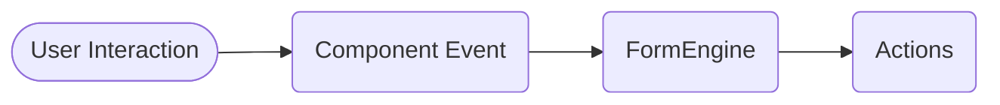

# Components with Events

Events enable components to respond to user interactions and communicate with other parts of your application. This guide covers creating
components with custom events, handling user interactions, and integrating with FormEngine's action system.

## Understanding Events in FormEngine

An event in FormEngine components occurs when a component property annotated
with [event](/api-reference/@react-form-builder/core/variables/event) is called. Event handlers, or actions, can be
attached to an event. Actions are simply functions (synchronous or asynchronous) that are executed sequentially, one after another.

See also [the section](/formengine-core/actions-and-events) on event handling.

### Event Flow

```
User Interaction → Component Event → FormEngine → Actions
```



**Example Flow:**

1. User clicks a button
2. Button's `onClick` event fires
3. FormEngine captures the event
4. Configured actions execute (validation, API calls, etc.)
5. UI updates based on action results

## Basic Event Implementation

### Example: Button with Custom Event

```tsx
import {boolean, define, event, string} from '@react-form-builder/core'

export const ActionButton = ({children, onClick, disabled, loading}: any) => {
  const handleClick = (event) => {
    if (!disabled && !loading) {
      onClick?.(event)
    }
  }

  return (
    <button
      className="action-button"
      onClick={handleClick}
      disabled={disabled || loading}
    >
      {loading && <span className="action-button__spinner">⟳</span>}
      <span className="action-button__text">{children}</span>
    </button>
  )
}

export const actionButton = define(ActionButton, 'ActionButton')
  .props({
    children: string.default('Click Me'),

    // Define an event prop
    onClick: event,

    disabled: boolean.default(false),
    loading: boolean.default(false)
  })
  .build()
```

**Usage in JSON:**

```json
{
  "key": "submitButton",
  "type": "ActionButton",
  "props": {
    "children": {
      "value": "Submit Form"
    }
  },
  "events": {
    "onClick": [
      {
        "name": "validate",
        "type": "common"
      },
      {
        "name": "log",
        "type": "common"
      }
    ]
  }
}
```

In this example, clicking the button will sequentially call two built-in event handlers. First, the `validate` action will be called, which
will validate the form, then the `log` action will be called, which will write the event data to the console.

#### Live Example

```jsx live
function App() {
  const ActionButton = ({children, onClick, disabled, loading}) => {
    const handleClick = (event) => {
      if (!disabled && !loading) {
        onClick?.(event)
      }
    }

    return (
      <button
        className="action-button"
        onClick={handleClick}
        disabled={disabled || loading}
      >
        {loading && <span className="action-button__spinner">⟳</span>}
        <span className="action-button__text">{children}</span>
      </button>
    )
  }

  const actionButton = define(ActionButton, 'ActionButton')
    .props({
      children: string.default('Click Me'),
      onClick: event,
      disabled: boolean.default(false),
      loading: boolean.default(false)
    })
    .build()

  const view = createView([actionButton.model])

  const formJson = {
    "form": {
      "key": "Screen",
      "type": "Screen",
      "children": [
        {
          "key": "submitButton",
          "type": "ActionButton",
          "props": {
            "children": {
              "value": "Submit Form"
            }
          },
          "events": {
            "onClick": [
              {
                "name": "validate",
                "type": "common"
              },
              {
                "name": "log",
                "type": "common"
              }
            ]
          }
        }
      ]
    }
  }

  return (
    <FormViewer
      view={view}
      getForm={() => JSON.stringify(formJson)}
      onFormDataChange={({data}) => {
        console.log(JSON.stringify(data))
      }}
    />
  )
}
```

## Event Types

### onChange Event

The most common event for input components:

```tsx
import {array, define, event, string} from '@react-form-builder/core'

const CustomSelect = ({value, onChange, options, placeholder}: any) => (
  <select
    value={value}
    onChange={e => onChange(e.target.value)}
  >
    <option value="">{placeholder}</option>
    {options.map(opt => (
      <option key={opt.value} value={opt.value}>
        {opt.label}
      </option>
    ))}
  </select>
)

export const customSelect = define(CustomSelect, 'CustomSelect')
  .props({
    value: string.valued.uncontrolledValue(''),
    onChange: event,
    options: array.default([]),
    placeholder: string.default('Select an option...')
  })
  .build()
```

#### Live Example

```jsx live
function App() {
  const CustomSelect = ({value, onChange, options, placeholder}) => (
    <select
      value={value}
      onChange={e => onChange(e.target.value)}
    >
      <option value="">{placeholder}</option>
      {options.map(opt => (
        <option key={opt.value} value={opt.value}>
          {opt.label}
        </option>
      ))}
    </select>
  )

  const customSelect = define(CustomSelect, 'CustomSelect')
    .props({
      value: string.valued.uncontrolledValue(''),
      onChange: event,
      options: array.default([]),
      placeholder: string.default('Select an option...')
    })
    .build()

  const view = createView([customSelect.model])

  const formJson = {
    "form": {
      "key": "Screen",
      "type": "Screen",
      "children": [
        {
          "key": "customSelect",
          "type": "CustomSelect",
          "props": {
            "options": {
              "value": [
                {
                  "label": "Mercedes",
                  "value": "m"
                },
                {
                  "label": "Toyota",
                  "value": "t"
                },
                {
                  "label": "Kia",
                  "value": "k"
                }
              ]
            }
          }
        }
      ]
    }
  }

  return (
    <FormViewer
      view={view}
      getForm={() => JSON.stringify(formJson)}
      onFormDataChange={({data}) => {
        console.log(JSON.stringify(data))
      }}
    />
  )
}
```

### onBlur and onFocus Events

For handling focus changes:

```tsx
import {define, event, string} from '@react-form-builder/core'
import {useState} from 'react'

const ValidatedInput = ({value, onChange, onBlur, onFocus, label}: any) => {
  const [isFocused, setIsFocused] = useState(false)

  const handleFocus = (e) => {
    setIsFocused(true)
    onFocus?.(e)
  }

  const handleBlur = (e) => {
    setIsFocused(false)
    onBlur?.(e)
  }

  return (
    <div className={`validated-input ${isFocused ? 'is-focused' : ''}`}>
      <label>{label} <input
        value={value}
        onChange={e => onChange(e.target.value)}
        onFocus={handleFocus}
        onBlur={handleBlur}
      />
      </label>
    </div>
  )
}

export const validatedInput = define(ValidatedInput, 'ValidatedInput')
  .props({
    value: string.valued.uncontrolledValue(''),
    label: string,
    onChange: event,
    onBlur: event,
    onFocus: event,
  })
  .build()
```

#### Live Example

```jsx live
function App() {
  const ValidatedInput = ({value, onChange, onBlur, onFocus, label}) => {
    const [isFocused, setIsFocused] = useState(false)

    const handleFocus = (e) => {
      setIsFocused(true)
      onFocus?.(e)
    }

    const handleBlur = (e) => {
      setIsFocused(false)
      onBlur?.(e)
    }

    return (
      <div className={`validated-input ${isFocused ? 'is-focused' : ''}`}>
        <label>{label} <input
          value={value}
          onChange={e => onChange(e.target.value)}
          onFocus={handleFocus}
          onBlur={handleBlur}
        />
        </label>
      </div>
    )
  }

  const validatedInput = define(ValidatedInput, 'ValidatedInput')
    .props({
      value: string.valued.uncontrolledValue(''),
      label: string,
      onChange: event,
      onBlur: event,
      onFocus: event,
    })
    .build()

  const view = createView([validatedInput.model])

  const formJson = {
    "actions": {
      "handleBlur": {
        "body": "e.store.formData.state.itemFocused = false"
      },
      "handleFocus": {
        "body": "e.store.formData.state.itemFocused = true"
      }
    },
    "form": {
      "key": "Screen",
      "type": "Screen",
      "children": [
        {
          "key": "validatedInput",
          "type": "ValidatedInput",
          "props": {
            "label": {
              "computeType": "function",
              "fnSource": "return 'MyLabel ' + (form.state.itemFocused ? 'focused' : 'unfocused')"
            }
          },
          "events": {
            "onBlur": [
              {
                "name": "handleBlur",
                "type": "code"
              }
            ],
            "onFocus": [
              {
                "name": "handleFocus",
                "type": "code"
              }
            ]
          }
        }
      ]
    }
  }

  return (
    <FormViewer
      view={view}
      getForm={() => JSON.stringify(formJson)}
      onFormDataChange={({data}) => {
        console.log(JSON.stringify(data))
      }}
    />
  )
}
```

In this example, saving the `itemFocused` variable to the [form state](/api-reference/@react-form-builder/core/interfaces/IFormData#state)
has been added to the event handlers. The label for the input is a computed property that depends on the form state.

For more information on saving user state, see [this section](/formengine-designer/faq/storing-user-defined-data) of the documentation.

## Testing Event Handling

```tsx
import {cleanup, fireEvent, render} from '@testing-library/react'
import {afterEach, describe, expect, test, vi} from 'vitest'
import {ActionButton} from './ActionButton'
import '@testing-library/jest-dom/vitest'

describe('ActionButton', () => {
  afterEach(() => {
    cleanup()
  })

  test('calls onClick when clicked', () => {
    const onClick = vi.fn()
    const {getByText} = render(
      <ActionButton onClick={onClick}>Click Me</ActionButton>
    )

    fireEvent.click(getByText('Click Me'))
    expect(onClick).toHaveBeenCalledTimes(1)
  })

  test('passes event data correctly', () => {
    const onClick = vi.fn()
    const {getByText} = render(
      <ActionButton onClick={onClick}>Click Me</ActionButton>
    )

    fireEvent.click(getByText('Click Me'))
    expect(onClick).toHaveBeenCalledWith(expect.any(Object))
  })

  test('respects disabled state', () => {
    const onClick = vi.fn()
    const {getByText} = render(
      <ActionButton onClick={onClick} disabled={true}>Click Me</ActionButton>
    )

    fireEvent.click(getByText('Click Me'))
    expect(onClick).not.toHaveBeenCalled()
  })

  test('shows loading state', async () => {
    const onClick = vi.fn(() => new Promise(resolve => setTimeout(resolve, 100)))
    const {getByText} = render(
      <ActionButton onClick={onClick} loading={true}>Click Me</ActionButton>
    )

    expect(getByText('⟳')).toBeInTheDocument()
  })
})
```

## Summary

Events are crucial for interactive components. Key points:

- Use the `event` type builder to define events
- Events receive the full form context automatically
- Can trigger common actions or custom logic
- Support async operations

**Next Steps:**

- Explore [Advanced Patterns](advanced-patterns) for complex component scenarios

Happy event handling! 🎉
