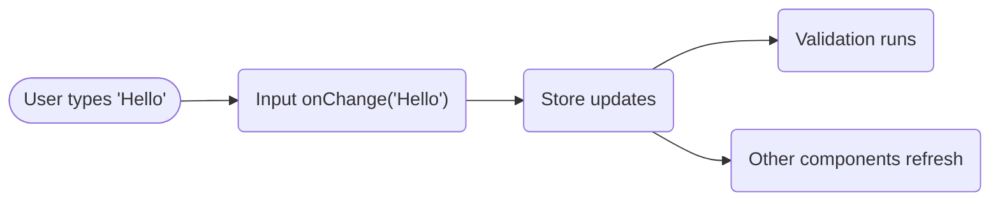

# Valued Components (Data Binding)

Valued components are interactive components that can read from and write to form data. They are the backbone of interactive forms, enabling
two-way data synchronization between the UI and the data model. This guide explains how to create components with data binding capabilities.

## What Are Valued Components?

Valued components are components that:

- ✅ Read data from the form store
- ✅ Write data back to the form store
- ✅ Support two-way data binding
- ✅ Trigger validation automatically
- ✅ Track dirty/touched state
- ✅ Integrate with FormEngine's reactive system

**Common Examples:**

- Text inputs
- Checkboxes and radio buttons
- Dropdown selects
- Date pickers
- Sliders and range inputs
- Custom interactive widgets

## Understanding Data Binding

Data binding is the automatic synchronization between a component's visual state and the form data store. When a user interacts with a
valued component:

1. **User Action** → User types in input, checks a box, etc.
2. **Component Update** → Component calls `onChange` with new value
3. **Store Update** → FormEngine updates the data store
4. **Validation** → Validation runs (if enabled)
5. **UI Sync** → All components bound to that data key update automatically

```
User types "Hello" → Input onChange("Hello") → Store updates → Validation runs → Other components refresh
```



## Creating Your First Valued Component

Use [valued](/api-reference/@react-form-builder/core/classes/TypedBuilder#valued) to set the component property that will be displayed in
the form data. Only one property of a component can be valued.

### Example: Custom Rating Component

Let's create a star rating component that stores a numeric value (1-5) in the form data.

```tsx
import {define, number, string} from '@react-form-builder/core'
import {useState} from 'react'

interface StarProps {
  color?: string
}

const Star = ({color}: StarProps) => (
  <svg
    width="24"
    height="24"
    viewBox="0 0 24 24"
    fill={color}
    stroke={color}
    strokeWidth="1"
  >
    <path d="M12 2l3.09 6.26L22 9.27l-5 4.87 1.18 6.88L12 17.77l-6.18 3.25L7 14.14 2 9.27l6.91-1.01L12 2z"/>
  </svg>
)

interface StarButtonProps {
  starNumber: number
  color?: string
  onClick?: () => void
  onMouseEnter?: () => void
}

const StarButton = ({
                      starNumber,
                      color,
                      onClick,
                      onMouseEnter
                    }: StarButtonProps) => {
  return <button
    type="button"
    className="star-rating__star"
    onClick={onClick}
    onMouseEnter={onMouseEnter}
    aria-label={`Rate ${starNumber} star${starNumber > 1 ? 's' : ''}`}
  >
    <Star color={color}/>
  </button>
}

// Step 1: Create the React component
interface StarRatingProps {
  /** Current rating value (1-5) */
  value: number;

  /** Called when rating changes */
  onChange?: (value: number) => void;

  /** Number of stars to show */
  maxStars?: number;

  /** Star color when active */
  activeColor?: string;

  /** Star color when inactive */
  inactiveColor?: string;
}

export const StarRating = ({
                             value,
                             onChange,
                             maxStars,
                             activeColor,
                             inactiveColor
                           }: StarRatingProps) => {
  const [hoveredStar, setHoveredStar] = useState<number | null>(null)

  const handleStarClick = (starValue: number) => {
    onChange?.(starValue)
  }

  const handleMouseEnter = (starValue: number) => {
    setHoveredStar(starValue)
  }

  const handleMouseLeave = () => {
    setHoveredStar(null)
  }

  const getStarColor = (starIndex: number) => {
    const effectiveRating = hoveredStar || value
    return starIndex <= effectiveRating ? activeColor : inactiveColor
  }

  return (
    <div
      className="star-rating"
      onMouseLeave={handleMouseLeave}
      aria-label={`Rating: ${value} out of ${maxStars}`}
    >
      {Array.from({length: maxStars}, (_, index) => {
        const starNumber = index + 1
        return (
          <StarButton
            key={starNumber}
            starNumber={starNumber}
            color={getStarColor(starNumber)}
            onClick={() => handleStarClick(starNumber)}
            onMouseEnter={() => handleMouseEnter(starNumber)}
          />
        )
      })}
      <span className="star-rating__value">{value || 0}</span>
    </div>
  )
}

// Step 2: Define it for FormEngine with data binding
export const starRating = define(StarRating, 'StarRating')
  .props({
    // This is the KEY prop - it enables data binding!
    value: number
      .valued, // ← This makes it a valued property!

    // Regular props (no data binding)
    maxStars: number.default(5),
    activeColor: string.default('#FFD700'),
    inactiveColor: string.default('#DDDDDD')
  })
  .build()
```

### Using the Rating Component

```json
{
  "key": "productRating",
  "type": "StarRating",
  "props": {
    "maxStars": {
      "value": 5
    },
    "activeColor": {
      "value": "#FFD700"
    }
  }
}
```

### Live Example

```jsx live
function App() {
  const Star = ({color}) => (
    <svg
      width="24"
      height="24"
      viewBox="0 0 24 24"
      fill={color}
      stroke={color}
      strokeWidth="1"
    >
      <path d="M12 2l3.09 6.26L22 9.27l-5 4.87 1.18 6.88L12 17.77l-6.18 3.25L7 14.14 2 9.27l6.91-1.01L12 2z"/>
    </svg>
  )

  const StarButton = ({
                        starNumber,
                        color,
                        onClick,
                        onMouseEnter
                      }) => {
    return <button
      type="button"
      className="star-rating__star"
      onClick={onClick}
      onMouseEnter={onMouseEnter}
      aria-label={`Rate ${starNumber} star${starNumber > 1 ? 's' : ''}`}
    >
      <Star color={color}/>
    </button>
  }

  const StarRating = ({
                        value,
                        onChange,
                        maxStars,
                        activeColor,
                        inactiveColor
                      }) => {
    const [hoveredStar, setHoveredStar] = useState(null)

    const handleStarClick = (starValue) => {
      onChange?.(starValue)
    }

    const handleMouseEnter = (starValue) => {
      setHoveredStar(starValue)
    }

    const handleMouseLeave = () => {
      setHoveredStar(null)
    }

    const getStarColor = (starIndex) => {
      const effectiveRating = hoveredStar || value
      return starIndex <= effectiveRating ? activeColor : inactiveColor
    }

    return (
      <div
        className="star-rating"
        onMouseLeave={handleMouseLeave}
        aria-label={`Rating: ${value} out of ${maxStars}`}
      >
        {Array.from({length: maxStars}, (_, index) => {
          const starNumber = index + 1
          return (
            <StarButton
              key={starNumber}
              starNumber={starNumber}
              color={getStarColor(starNumber)}
              onClick={() => handleStarClick(starNumber)}
              onMouseEnter={() => handleMouseEnter(starNumber)}
            />
          )
        })}
        <span className="star-rating__value">{value || 0}</span>
      </div>
    )
  }

  const starRating = define(StarRating, 'StarRating')
    .props({
      value: number.valued,
      maxStars: number.default(5),
      activeColor: string.default('#FFD700'),
      inactiveColor: string.default('#DDDDDD')
    })
    .build()

  const view = createView([starRating.model])

  const formJson = {
    "form": {
      "key": "Screen",
      "type": "Screen",
      "children": [
        {
          "key": "productRating",
          "type": "StarRating",
          "props": {
            "maxStars": {
              "value": 5
            },
            "activeColor": {
              "value": "#FFD700"
            }
          }
        }
      ]
    }
  }

  return (
    <FormViewer
      view={view}
      getForm={() => JSON.stringify(formJson)}
      onFormDataChange={({data}) => {
        console.log(JSON.stringify(data))
      }}
    />
  )
}
```

**What happens:**

1. Component renders with current value from form data (or 0 if not set)
2. User clicks on stars → `onChange` is called with new value
3. FormEngine automatically updates [form.data](/api-reference/@react-form-builder/core/interfaces/IFormData#data).productRating
4. Validation runs if configured
5. Component re-renders with new value

## Understanding the .valued Property

The `.valued` modifier is what transforms a regular prop into a data-bound prop:

```typescript
// Regular prop - just passes a value
regularProp: string

// Valued prop - connects to form data
valuedProp: string.valued

// Valued prop with uncontrolled behavior
uncontrolledProp: string.valued.uncontrolledValue('default')
```

### How .valued Changes Behavior

| Feature                | Regular Prop | Valued Prop      |
|------------------------|--------------|------------------|
| Gets value from        | Props        | Form data store  |
| Updates trigger        | Nothing      | Form data update |
| Validates              | No           | Yes              |
| Tracks dirty state     | No           | Yes              |
| Available in form data | No           | Yes              |

## Valued Property Types

### String Valued Props

```tsx
import {define, string} from '@react-form-builder/core'

const CustomInput = ({value, onChange, placeholder}: any) => (
  <input
    value={value}
    onChange={e => onChange(e.target.value)}
    placeholder={placeholder}
  />
)

export const customInput = define(CustomInput, 'CustomInput')
  .props({
    value: string
      .valued
      .uncontrolledValue(''),

    placeholder: string.default('Enter text...')
  })
  .build()
```

#### Live Example

```jsx live
function App() {
  const CustomInput = ({value, onChange, placeholder}) => (
    <input
      value={value}
      onChange={e => onChange(e.target.value)}
      placeholder={placeholder}
    />
  )

  const customInput = define(CustomInput, 'CustomInput')
    .props({
      value: string
        .valued
        .uncontrolledValue(''),

      placeholder: string.default('Enter text...')
    })
    .build()

  const view = createView([customInput.model])

  const formJson = {
    "form": {
      "key": "Screen",
      "type": "Screen",
      "children": [
        {
          "key": "customInput",
          "type": "CustomInput"
        }
      ]
    }
  }

  return (
    <FormViewer
      view={view}
      getForm={() => JSON.stringify(formJson)}
      onFormDataChange={({data}) => {
        console.log(JSON.stringify(data))
      }}
    />
  )
}
```

**What happens:**

1. Component renders with current value from form data (or 0 if not set)
2. User clicks on stars → `onChange` is called with new value
3. FormEngine automatically updates [form.data](/api-reference/@react-form-builder/core/interfaces/IFormData#data).productRating
4. Validation runs if configured
5. Component re-renders with new value

### Number Valued Props

```tsx
import {define, number} from '@react-form-builder/core'

const NumberSpinner = ({value = 0, onChange, min, max}: any) => {
  const increment = () => onChange(Math.min(value + 1, max))
  const decrement = () => onChange(Math.max(value - 1, min))

  return (
    <div className="number-spinner">
      <button onClick={decrement}>-</button>
      <span>{value}</span>
      <button onClick={increment}>+</button>
    </div>
  )
}

export const numberSpinner = define(NumberSpinner, 'NumberSpinner')
  .props({
    value: number.valued,
    min: number.default(0),
    max: number.default(100)
  })
  .build()
```

#### Live Example

```jsx live
function App() {
  const NumberSpinner = ({value = 0, onChange, min, max}) => {
    const increment = () => onChange(Math.min(value + 1, max))
    const decrement = () => onChange(Math.max(value - 1, min))

    return (
      <div className="number-spinner">
        <button onClick={decrement}>-</button>
        <span>{value}</span>
        <button onClick={increment}>+</button>
      </div>
    )
  }

  const numberSpinner = define(NumberSpinner, 'NumberSpinner')
    .props({
      value: number.valued,
      min: number.default(0),
      max: number.default(100)
    })
    .build()

  const view = createView([numberSpinner.model])

  const formJson = {
    "form": {
      "key": "Screen",
      "type": "Screen",
      "children": [
        {
          "key": "numberSpinner",
          "type": "NumberSpinner"
        }
      ]
    }
  }

  return (
    <FormViewer
      view={view}
      getForm={() => JSON.stringify(formJson)}
      onFormDataChange={({data}) => {
        console.log(JSON.stringify(data))
      }}
    />
  )
}
```

### Boolean Valued Props

```tsx
import {boolean, define, string} from '@react-form-builder/core'

const ToggleSwitch = ({value, onChange, label}: any) => (
  <label className="toggle-switch">
    <span>{label}</span>
    <input
      type="checkbox"
      checked={value}
      onChange={e => onChange(e.target.checked)}
    />
    <span className="toggle-switch__slider"/>
  </label>
)

export const toggleSwitch = define(ToggleSwitch, 'ToggleSwitch')
  .props({
    value: boolean.valued.uncontrolledValue(false),
    label: string.default('Enable feature')
  })
  .build()
```

#### Live Example

```jsx live
function App() {
  const ToggleSwitch = ({value, onChange, label}) => (
    <label className="toggle-switch">
      <span>{label}</span>
      <input
        type="checkbox"
        checked={value}
        onChange={e => onChange(e.target.checked)}
      />
      <span className="toggle-switch__slider"/>
    </label>
  )

  const toggleSwitch = define(ToggleSwitch, 'ToggleSwitch')
    .props({
      value: boolean.valued.uncontrolledValue(false),
      label: string.default('Enable feature')
    })
    .build()

  const view = createView([toggleSwitch.model])

  const formJson = {
    "form": {
      "key": "Screen",
      "type": "Screen",
      "children": [
        {
          "key": "toggleSwitch",
          "type": "ToggleSwitch"
        }
      ]
    }
  }

  return (
    <FormViewer
      view={view}
      getForm={() => JSON.stringify(formJson)}
      onFormDataChange={({data}) => {
        console.log(JSON.stringify(data))
      }}
    />
  )
}
```

### Array Valued Props

```tsx
import {array, define} from '@react-form-builder/core'

const MultiSelect = ({value = [], onChange, options}: any) => {
  const handleToggle = (optionValue) => {
    const newValue = value.includes(optionValue)
      ? value.filter(v => v !== optionValue)
      : [...value, optionValue]
    onChange(newValue)
  }

  return (
    <div className="multi-select">
      {options.map(option => (
        <label key={option.value}>
          <input
            type="checkbox"
            checked={value.includes(option.value)}
            onChange={() => handleToggle(option.value)}
          />
          {option.label}
        </label>
      ))}
    </div>
  )
}

export const multiSelect = define(MultiSelect, 'MultiSelect')
  .props({
    value: array.valued,
    options: array
      .default([
        {value: 'option1', label: 'Option 1'},
        {value: 'option2', label: 'Option 2'}
      ])
  })
  .build()
```

#### Live Example

```jsx live
function App() {
  const MultiSelect = ({value = [], onChange, options}) => {
    const handleToggle = (optionValue) => {
      const newValue = value.includes(optionValue)
        ? value.filter(v => v !== optionValue)
        : [...value, optionValue]
      onChange(newValue)
    }

    return (
      <div className="multi-select">
        {options.map(option => (
          <label key={option.value}>
            <input
              type="checkbox"
              checked={value.includes(option.value)}
              onChange={() => handleToggle(option.value)}
            />
            {option.label}
          </label>
        ))}
      </div>
    )
  }

  const multiSelect = define(MultiSelect, 'MultiSelect')
    .props({
      value: array.valued,
      options: array
        .default([
          {value: 'option1', label: 'Option 1'},
          {value: 'option2', label: 'Option 2'}
        ])
    })
    .build()

  const view = createView([multiSelect.model])

  const formJson = {
    "form": {
      "key": "Screen",
      "type": "Screen",
      "children": [
        {
          "key": "multiSelect",
          "type": "MultiSelect"
        }
      ]
    }
  }

  return (
    <FormViewer
      view={view}
      getForm={() => JSON.stringify(formJson)}
      onFormDataChange={({data}) => {
        console.log(JSON.stringify(data))
      }}
    />
  )
}
```

## Advanced Data Binding Patterns

### Uncontrolled Valued Props

If the `valued` component must have a value other than `undefined`, then add
an [uncontrolledValue](/api-reference/@react-form-builder/core/classes/TypedBuilder#uncontrolledvalue), then FormEngine will substitute the
value from `uncontrolledValue` instead of `undefined`.

```tsx
import {define, number, string} from '@react-form-builder/core'
import {useEffect, useState} from 'react'

const DebouncedInput = ({value, onChange, delay}: any) => {
  const [internalValue, setInternalValue] = useState(value)

  useEffect(() => {
    const timeout = setTimeout(() => {
      onChange(internalValue)
    }, delay)

    return () => clearTimeout(timeout)
  }, [internalValue, delay, onChange])

  return (
    <input
      value={internalValue}
      onChange={e => setInternalValue(e.target.value)}
    />
  )
}

export const debouncedInput = define(DebouncedInput, 'DebouncedInput')
  .props({
    value: string
      .valued
      .uncontrolledValue(''), // Component manages initial state

    delay: number.default(300)
  })
  .build()
```

#### Live Example

```jsx live
function App() {
  const DebouncedInput = ({value, onChange, delay}) => {
    const [internalValue, setInternalValue] = useState(value)

    useEffect(() => {
      const timeout = setTimeout(() => {
        onChange(internalValue)
      }, delay)

      return () => clearTimeout(timeout)
    }, [internalValue, delay, onChange])

    return (
      <input
        value={internalValue}
        onChange={e => setInternalValue(e.target.value)}
      />
    )
  }

  const debouncedInput = define(DebouncedInput, 'DebouncedInput')
    .props({
      value: string
        .valued
        .uncontrolledValue(''), // Component manages initial state

      delay: number.default(300)
    })
    .build()

  const view = createView([debouncedInput.model])

  const formJson = {
    "form": {
      "key": "Screen",
      "type": "Screen",
      "children": [
        {
          "key": "debouncedInput",
          "type": "DebouncedInput"
        }
      ]
    }
  }

  return (
    <FormViewer
      view={view}
      getForm={() => JSON.stringify(formJson)}
      onFormDataChange={({data}) => {
        console.log(JSON.stringify(data))
      }}
    />
  )
}
```

### Validation Integration

Valued components automatically participate in validation:

```tsx
import {define, number} from '@react-form-builder/core'

const AgeInput = ({value = 0, onChange}: any) => (
  <input
    type="number"
    value={value}
    onChange={e => onChange(Number(e.target.value))}
    min="0"
    max="150"
  />
)

export const ageInput = define(AgeInput, 'AgeInput')
  .props({
    value: number.valued
  })
  .build()
```

#### Live Example

```jsx live
function App() {
  const AgeInput = ({value = 0, onChange}) => (
    <input
      type="number"
      value={value}
      onChange={e => onChange(Number(e.target.value))}
      min="0"
      max="150"
    />
  )

  const ageInput = define(AgeInput, 'AgeInput')
    .props({
      value: number.valued
    })
    .build()

  const view = createView([ageInput.model])

  const formJson = {
    "form": {
      "key": "Screen",
      "type": "Screen",
      "children": [
        {
          "key": "ageInput",
          "type": "AgeInput",
          "schema": {
            "validations": [
              {
                "key": "min",
                "args": {
                  "limit": 0
                }
              },
              {
                "key": "max",
                "args": {
                  "limit": 10
                }
              }
            ]
          }
        }
      ]
    }
  }

  return (
    <FormViewer
      view={view}
      getForm={() => JSON.stringify(formJson)}
      onFormDataChange={({data}) => {
        console.log(JSON.stringify(data))
      }}
    />
  )
}
```

## Real-World Example: Color Picker

```tsx
import {array, define, string} from '@react-form-builder/core'
import {useState} from 'react'

const ColorPicker = ({value = '#000000', onChange, presetColors = []}: any) => {
  const [showCustom, setShowCustom] = useState(false)
  const [customColor, setCustomColor] = useState('#000000')

  const colors = presetColors.length > 0 ? presetColors : [
    '#FF6B6B', '#4ECDC4', '#45B7D1', '#96CEB4', '#FFEAA7',
    '#DDA0DD', '#98D8C8', '#F7DC6F', '#BB8FCE', '#85C1E9'
  ]

  const handleColorSelect = (color) => {
    onChange(color)
    setShowCustom(false)
  }

  const handleCustomColor = () => {
    onChange(customColor)
    setShowCustom(false)
  }

  return (
    <div className="color-picker" style={{display: 'flex', flexDirection: 'column', gap: 5, maxWidth: 200}}>
      <div className="color-picker__grid" style={{display: 'flex', gap: 5}}>
        {colors.map(color => (
          <button
            key={color}
            className={`color-picker__swatch ${value === color ? 'is-selected' : ''}`}
            style={{backgroundColor: color, height: 35, width: 40, border: 'none', borderRadius: 10}}
            onClick={() => handleColorSelect(color)}
            aria-label={`Select color ${color}`}
          />
        ))}
      </div>

      <button
        className="color-picker__custom-btn"
        onClick={() => setShowCustom(!showCustom)}
      >
        Custom Color
      </button>

      {showCustom && (
        <div className="color-picker__custom">
          <input
            type="color"
            value={customColor}
            onChange={e => setCustomColor(e.target.value)}
          />
          <button onClick={handleCustomColor}>Apply</button>
        </div>
      )}

      <div className="color-picker__selected">
        Selected: <span style={{color: value}}>{value}</span>
      </div>
    </div>
  )
}

export const colorPicker = define(ColorPicker, 'ColorPicker')
  .props({
    value: string.valued,
    presetColors: array
      .default([
        '#FF6B6B', '#4ECDC4', '#45B7D1', '#96CEB4', '#FFEAA7'
      ])
  })
  .build()
```

**Usage in Form:**

```json
{
  "key": "favoriteColor",
  "type": "ColorPicker",
  "props": {
    "presetColors": {
      "value": [
        "#FF0000",
        "#00FF00",
        "#0000FF",
        "#FFFF00",
        "#FF00FF"
      ]
    }
  }
}
```

#### Live Example

```jsx live
function App() {
  const ColorPicker = ({value = '#000000', onChange, presetColors = []}) => {
    const [showCustom, setShowCustom] = useState(false)
    const [customColor, setCustomColor] = useState('#000000')

    const colors = presetColors.length > 0 ? presetColors : [
      '#FF6B6B', '#4ECDC4', '#45B7D1', '#96CEB4', '#FFEAA7',
      '#DDA0DD', '#98D8C8', '#F7DC6F', '#BB8FCE', '#85C1E9'
    ]

    const handleColorSelect = (color) => {
      onChange(color)
      setShowCustom(false)
    }

    const handleCustomColor = () => {
      onChange(customColor)
      setShowCustom(false)
    }

    return (
      <div className="color-picker" style={{display: 'flex', flexDirection: 'column', gap: 5, maxWidth: 200}}>
        <div className="color-picker__grid" style={{display: 'flex', gap: 5}}>
          {colors.map(color => (
            <button
              key={color}
              className={`color-picker__swatch ${value === color ? 'is-selected' : ''}`}
              style={{backgroundColor: color, height: 35, width: 40, border: 'none', borderRadius: 10}}
              onClick={() => handleColorSelect(color)}
              aria-label={`Select color ${color}`}
            />
          ))}
        </div>

        <button
          className="color-picker__custom-btn"
          onClick={() => setShowCustom(!showCustom)}
        >
          Custom Color
        </button>

        {showCustom && (
          <div className="color-picker__custom">
            <input
              type="color"
              value={customColor}
              onChange={e => setCustomColor(e.target.value)}
            />
            <button onClick={handleCustomColor}>Apply</button>
          </div>
        )}

        <div className="color-picker__selected">
          Selected: <span style={{color: value}}>{value}</span>
        </div>
      </div>
    )
  }

  const colorPicker = define(ColorPicker, 'ColorPicker')
    .props({
      value: string.valued,
      presetColors: array
        .default([
          '#FF6B6B', '#4ECDC4', '#45B7D1', '#96CEB4', '#FFEAA7'
        ])
    })
    .build()

  const view = createView([colorPicker.model])

  const formJson = {
    "form": {
      "key": "Screen",
      "type": "Screen",
      "children": [
        {
          "key": "favoriteColor",
          "type": "ColorPicker",
          "props": {
            "presetColors": {
              "value": [
                "#FF0000",
                "#00FF00",
                "#0000FF",
                "#FFFF00",
                "#FF00FF"
              ]
            }
          }
        }
      ]
    }
  }

  return (
    <FormViewer
      view={view}
      getForm={() => JSON.stringify(formJson)}
      onFormDataChange={({data}) => {
        console.log(JSON.stringify(data))
      }}
    />
  )
}
```

## Testing Valued Components

```tsx
import {cleanup, fireEvent, render} from '@testing-library/react'
import {afterEach, describe, expect, test, vi} from 'vitest'
import {StarRating} from './StarRating'
import '@testing-library/jest-dom/vitest'

describe('StarRating', () => {
  afterEach(() => {
    cleanup()
  })

  test('renders with initial value', () => {
    const onChange = vi.fn()
    const {getByLabelText} = render(
      <StarRating value={3} onChange={onChange} maxStars={5}/>
    )

    expect(getByLabelText('Rating: 3 out of 5')).toBeInTheDocument()
  })

  test('calls onChange when star is clicked', () => {
    const onChange = vi.fn()
    const {getByLabelText} = render(
      <StarRating value={0} onChange={onChange} maxStars={10}/>
    )

    fireEvent.click(getByLabelText('Rate 3 stars'))
    expect(onChange).toHaveBeenCalledWith(3)
  })

  test('respects maxStars prop', () => {
    const onChange = vi.fn()
    const {queryByLabelText} = render(
      <StarRating value={0} onChange={onChange} maxStars={3}/>
    )

    expect(queryByLabelText('Rate 4 stars')).not.toBeInTheDocument()
  })
})
```

## Common Patterns

### Pattern 1: Input with Clear Button

```tsx
import {define, string} from '@react-form-builder/core'

const ClearableInput = ({value, onChange, placeholder}: any) => {
  const handleClear = () => onChange(undefined)

  return (
    <div className="clearable-input">
      <input
        value={value}
        onChange={e => onChange(e.target.value)}
        placeholder={placeholder}
      />
      {value && (
        <button
          type="button"
          onClick={handleClear}
          aria-label="Clear input"
        >
          ✕
        </button>
      )}
    </div>
  )
}

export const clearableInput = define(ClearableInput, 'ClearableInput')
  .props({
    value: string.valued.uncontrolledValue(''),
    placeholder: string.default('Enter text...')
  })
  .build()
```

#### Live Example

```jsx live
function App() {
  const ClearableInput = ({value, onChange, placeholder}) => {
    const handleClear = () => onChange(undefined)

    return (
      <div className="clearable-input">
        <input
          value={value}
          onChange={e => onChange(e.target.value)}
          placeholder={placeholder}
        />
        {value && (
          <button
            type="button"
            onClick={handleClear}
            aria-label="Clear input"
          >
            ✕
          </button>
        )}
      </div>
    )
  }

  const clearableInput = define(ClearableInput, 'ClearableInput')
    .props({
      value: string.valued.uncontrolledValue(''),
      placeholder: string.default('Enter text...')
    })
    .build()

  const view = createView([clearableInput.model])

  const formJson = {
    "form": {
      "key": "Screen",
      "type": "Screen",
      "children": [
        {
          "key": "clearableInput",
          "type": "ClearableInput"
        }
      ]
    }
  }

  return (
    <FormViewer
      view={view}
      getForm={() => JSON.stringify(formJson)}
      onFormDataChange={({data}) => {
        console.log(JSON.stringify(data))
      }}
    />
  )
}
```

### Pattern 2: Toggle Group

```tsx
import {array, define, string} from '@react-form-builder/core'

const ToggleGroup = ({value, onChange, options}: any) => (
  <div className="toggle-group" style={{display: 'flex', gap: 5}}>
    {options.map(option => (
      <button
        key={option.value}
        type="button"
        className={`toggle-group__item ${value === option.value ? 'is-active' : ''}`}
        style={{backgroundColor: value === option.value ? 'lightblue' : 'lightgray'}}
        onClick={() => onChange(option.value)}
      >
        {option.label}
      </button>
    ))}
  </div>
)

export const toggleGroup = define(ToggleGroup, 'ToggleGroup')
  .props({
    value: string.valued,
    options: array.default([
      {value: 'yes', label: 'Yes'},
      {value: 'no', label: 'No'}
    ])
  })
  .build()
```

#### Live Example

```jsx live
function App() {
  const ToggleGroup = ({value, onChange, options}) => (
    <div className="toggle-group" style={{display: 'flex', gap: 5}}>
      {options.map(option => (
        <button
          key={option.value}
          type="button"
          className={`toggle-group__item ${value === option.value ? 'is-active' : ''}`}
          style={{backgroundColor: value === option.value ? 'lightblue' : 'lightgray'}}
          onClick={() => onChange(option.value)}
        >
          {option.label}
        </button>
      ))}
    </div>
  )

  const toggleGroup = define(ToggleGroup, 'ToggleGroup')
    .props({
      value: string.valued,
      options: array.default([
        {value: 'yes', label: 'Yes'},
        {value: 'no', label: 'No'}
      ])
    })
    .build()

  const view = createView([toggleGroup.model])

  const formJson = {
    "form": {
      "key": "Screen",
      "type": "Screen",
      "children": [
        {
          "key": "toggleGroup",
          "type": "ToggleGroup"
        }
      ]
    }
  }

  return (
    <FormViewer
      view={view}
      getForm={() => JSON.stringify(formJson)}
      onFormDataChange={({data}) => {
        console.log(JSON.stringify(data))
      }}
    />
  )
}
```

## Overriding existing event handlers

Sometimes you need to work with third-party components that have different `onChange` event handler signatures. For example, some components
pass the event object as the first parameter instead of the value. FormEngine Core provides a way to handle this through the
[overrideEventHandlers](/api-reference/@react-form-builder/core/interfaces/Definer#overrideeventhandlers) function.

### When to Use overrideEventHandlers

Use `overrideEventHandlers` when:

- A component's `onChange` handler receives an event object instead of a value
- You need to extract the value from a complex event object
- The component uses non-standard event names (e.g., `onSelect` instead of `onChange`)
- You need to transform the event data before it reaches the form store

### Built-in Event Handlers in FormEngine Core

FormEngine Core currently provides two built-in event handlers:

1. `onChange` - Triggered when a component's value changes
2. `onBlur` - Triggered when a component loses focus

### Example: Overriding onChange for Event Object

Below is an example of redefining the `onChange` and `onBlur` events for the `Input` component from the `@mui/material` library:

```typescript
import {Input} from '@mui/material'
import type {ActionEventArgs} from '@react-form-builder/core'
import {define, string} from '@react-form-builder/core'

export const matInput = define(Input, 'MatInput')
  .name('Input')
  .props({
    value: string.valued.uncontrolledValue('')
  })
  .overrideEventHandlers({
    onChange: (e: ActionEventArgs) => {
      const value = e.args[0].target.value
      e.sender.field?.setValue(value)
    },
    // optional, to track the touched field property
    onBlur: (e: ActionEventArgs) => {
      e.sender.field?.setTouched()
    },
  })
```

## Summary

Valued components are essential for creating interactive forms. Key points:

- Use `.valued` to enable data binding
- Components receive `value` and `onChange` props automatically
- FormEngine handles store synchronization
- Validation runs automatically
- Supports all data types (string, number, boolean, array, object)

**Next Steps:**

- Learn about [Components with Events](component-with-events) to handle user interactions
- Check out [Advanced Patterns](advanced-patterns) for complex scenarios

Happy coding! 🎯
