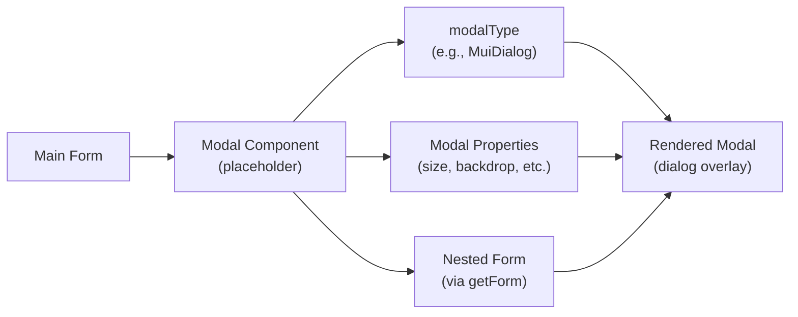

# Modal Forms & Pop-up Dialogs - User Interactions

Modal windows in FormEngine Core allow you to display nested forms in overlay dialogs that appear above the main form content. Modals are
perfect for confirmation dialogs, detailed edit forms, additional information panels, or any secondary interaction that should temporarily
interrupt the user's workflow.

In this guide, you'll learn:

- How modal windows work with the `Modal` component and `modalType` configuration
- How to open and close modals using `openModal` and `closeModal` actions
- How to pass data between the main form and modal windows
- How to use built-in modal components and create custom ones
- Practical examples for common modal use cases

## How modal windows work

Modal windows in FormEngine Core are built on top of [embedded forms](/formengine-core/embedded-forms). A modal displays a nested form
inside a dialog overlay, with the following architecture:

1. **Modal component**: The `Modal` component serves as a placeholder in your form definition
2. **Modal type**: The `modalType` setting specifies which UI component renders the actual dialog (e.g., `RsModal`, `MuiDialog`)
3. **Modal properties**: The `modal` field in the component's JSON defines properties for the dialog component
4. **Nested form**: The modal displays a form template loaded via the `getForm` callback



## Configuring modal windows

### Setting the modal type

The [modalType](/api-reference/@react-form-builder/core/interfaces/PersistedForm#modaltype) property in your form JSON specifies which
component library should render modal dialogs. This is typically set at the root level of your form definition:

```json lines title='Form with modal type configuration'
{
  "modalType": "MuiDialog",
  "form": {
    "key": "Screen",
    "type": "Screen",
    "children": [
      // Form components...
    ]
  }
}
```

Common modal type values include:

- "MuiDialog" for Material UI components
- "RsModal" for React Suite components
- Your custom modal component type

### Defining a modal component

Use the `Modal` component type to create a modal placeholder in your form. The `modalTemplate` property specifies which form template to
load inside the modal:

```json title='Modal component definition'
{
  "key": "confirmationModal",
  "type": "Modal",
  "props": {
    "modalTemplate": {
      "value": "Template:confirmation-dialog"
    }
  },
  "modal": {
    "props": {
      "size": {
        "value": "sm"
      },
      "backdrop": {
        "value": true
      }
    },
    "events": {}
  }
}
```

### Modal component properties

The `modal` field defines properties for the actual dialog component (specified by `modalType`). These properties vary depending on your
component library:

```json showLineNumbers {9-24}
{
  "key": "confirmationModal",
  "type": "Modal",
  "props": {
    "modalTemplate": {
      "value": "Template:confirmation-dialog"
    }
  },
  "modal": {
    "props": {
      "size": {
        "value": "md"
      },
      "backdrop": {
        "value": true
      },
      "keyboard": {
        "value": true
      },
      "enforceFocus": {
        "value": true
      }
    }
  }
}
```

## Opening and closing modals

### The openModal action

Use the `openModal` action to display a modal window. This action accepts several parameters:

```json
{
  "name": "openModal",
  "type": "common",
  "args": {
    "modalKey": "confirmationModal",
    "useFormData": true,
    "beforeShow": {
      "type": "fn",
      "body": "  // Optional pre-show logic\n  if (e.data.requiresConfirmation === false) return false\n  return {initialValue: e.data.userInput}"
    },
    "beforeHide": {
      "type": "fn",
      "body": "  // Optional pre-close logic\n  if (args.result === 'confirmed') {\n    return {confirmedData: e.data.modalInput}\n  }\n  return {cancelled: true}"
    }
  }
}
```

#### openModal parameters

| Parameter     | Type       | Description                                                                                                                      |
|---------------|------------|----------------------------------------------------------------------------------------------------------------------------------|
| `modalKey`    | `string`   | **Required.** The key of the `Modal` component to open                                                                           |
| `useFormData` | `boolean`  | If `true`, passes the current form data to the modal as initial data                                                             |
| `beforeShow`  | `function` | Optional function executed before the modal opens. Return `false` to cancel opening, or return an object to pass as initial data |
| `beforeHide`  | `function` | Optional function executed before the modal closes. Return value is passed to the main form when modal closes                    |

### The closeModal action

Use the `closeModal` action to programmatically close the currently open modal:

```json
{
  "name": "closeModal",
  "type": "common",
  "args": {
    "result": "userConfirmed"
  }
}
```

The `result` parameter is optional and can be any value that will be available to the `beforeHide` function and main form after closure.

## Data flow between forms and modals

### Passing data to modals

You can pass initial data to a modal in two ways:

1. **Using `useFormData: true`**: Passes the entire form data to the modal
2. **Using `beforeShow` function**: Allows selective data passing or transformation

```json title='Passing form data to modal'
{
  "events": {
    "onClick": [
      {
        "name": "openModal",
        "type": "common",
        "args": {
          "modalKey": "editModal",
          "useFormData": true
        }
      }
    ]
  }
}
```

```json title='Selective data passing'
{
  "events": {
    "onClick": [
      {
        "name": "openModal",
        "type": "common",
        "args": {
          "modalKey": "editModal",
          "beforeShow": {
            "type": "fn",
            "body": "  return {userId: e.data.selectedUserId, editMode: true}"
          }
        }
      }
    ]
  }
}
```

### Receiving data from modals

When a modal closes, data can be returned to the main form through:

1. **`beforeHide` function**: Processes data before returning to main form
2. **Modal close with result**: The `closeModal` action's `result` parameter

```json title='Processing modal results'
{
  "events": {
    "onClick": [
      {
        "name": "openModal",
        "type": "common",
        "args": {
          "modalKey": "settingsModal",
          "beforeHide": {
            "type": "fn",
            "body": "  if (args.result === 'save') {\n    // Update main form with modal data\n    return {\n      updatedSettings: e.data,\n      lastUpdated: new Date().toISOString()\n    }\n  }\n  return {cancelled: true}"
          }
        }
      }
    ]
  }
}
```

## Live examples

### Simple confirmation dialog

A basic modal that asks for user confirmation:

```jsx live
function App() {
  const mainForm = useMemo(() => ({
    modalType: 'MuiDialog',
    form: {
      key: 'Screen',
      type: 'Screen',
      children: [
        {
          key: 'deleteButton',
          type: 'MuiButton',
          props: {
            variant: {value: 'contained'},
            color: {value: 'error'},
            children: {value: 'Delete Item'}
          },
          events: {
            onClick: [
              {
                name: 'openModal',
                type: 'common',
                args: {
                  modalKey: 'confirmDeleteModal',
                  beforeHide: {
                    type: "fn",
                    body: 'if (args.result === "confirmed") { alert("The item has been deleted"); }'
                  }
                }
              }
            ]
          }
        },
        {
          key: 'confirmDeleteModal',
          type: 'Modal',
          props: {
            modalTemplate: {value: 'Template:confirmation-dialog'}
          },
          modal: {
            props: {
              maxWidth: {value: 'sm'}
            }
          }
        }
      ]
    }
  }), [])

  const confirmationForm = useMemo(() => ({
    form: {
      key: 'Screen',
      type: 'Screen',
      children: [
        {
          key: 'message',
          type: 'MuiTypography',
          props: {
            children: {value: 'Are you sure you want to delete this item?'},
            variant: {value: 'h6'}
          }
        },
        {
          key: 'buttonContainer',
          type: 'MuiBox',
          css: {
            any: {
              object: {
                display: 'flex',
                justifyContent: 'flex-end',
                gap: '10px',
                marginTop: '20px'
              }
            }
          },
          children: [
            {
              key: 'cancelButton',
              type: 'MuiButton',
              props: {
                children: {value: 'Cancel'}
              },
              events: {
                onClick: [
                  {
                    name: 'closeModal',
                    type: 'common',
                    args: {result: 'cancelled'}
                  }
                ]
              }
            },
            {
              key: 'confirmButton',
              type: 'MuiButton',
              props: {
                variant: {value: 'contained'},
                color: {value: 'error'},
                children: {value: 'Delete'}
              },
              events: {
                onClick: [
                  {
                    name: 'closeModal',
                    type: 'common',
                    args: {result: 'confirmed'}
                  }
                ]
              }
            }
          ]
        }
      ]
    }
  }), [])

  const getForm = useCallback((formName, options) => {
    if (formName === 'confirmation-dialog') {
      return JSON.stringify(confirmationForm)
    }
    return JSON.stringify(mainForm)
  }, [mainForm, confirmationForm])

  return <FormViewer view={muiView} getForm={getForm}/>
}
```

### Data editing modal

A modal that allows editing form data with two-way data transfer:

```jsx live
function App() {
  const mainForm = useMemo(() => ({
    modalType: 'MuiDialog',
    form: {
      key: 'Screen',
      type: 'Screen',
      children: [
        {
          key: 'userInfo',
          type: 'MuiBox',
          css: {
            any: {
              object: {
                padding: '20px',
                border: '1px solid #e5e5e5',
                borderRadius: '6px',
                marginBottom: '20px'
              }
            }
          },
          children: [
            {
              key: 'userName',
              type: 'MuiTextField',
              props: {
                value: {value: 'John Doe'},
                readOnly: {value: true},
                label: {value: 'Current Name'},
                helperText: {
                  computeType: "function",
                  fnSource: "return form.data.lastUpdated ? `Last updated: ${form.data.lastUpdated}` : 'Not modified yet'"
                }
              }
            }
          ]
        },
        {
          key: 'editButton',
          type: 'MuiButton',
          props: {
            variant: {value: 'contained'},
            children: {value: 'Edit Profile'}
          },
          events: {
            onClick: [
              {
                name: 'openModal',
                type: 'common',
                args: {
                  modalKey: 'editProfileModal',
                  useFormData: true,
                  beforeHide: {
                    type: 'fn',
                    body: `  if (args.result === 'save') {
                      // Return updated data to main form
                      return {
                        userName: e.data.userName,
                        lastUpdated: new Date().toLocaleTimeString()
                      }
                    }
                    return null`
                  }
                }
              }
            ]
          }
        },
        {
          key: 'editProfileModal',
          type: 'Modal',
          props: {
            modalTemplate: {value: 'Template:edit-profile'}
          },
          modal: {
            props: {
              maxWidth: {value: 'md'},
              fullWidth: {value: true}
            }
          }
        }
      ]
    }
  }), [])

  const editForm = useMemo(() => ({
    form: {
      key: 'Screen',
      type: 'Screen',
      children: [
        {
          key: 'formTitle',
          type: 'MuiTypography',
          props: {
            children: {value: 'Edit Profile'},
            variant: {value: 'h4'}
          }
        },
        {
          key: 'userName',
          type: 'MuiTextField',
          props: {
            label: {value: 'Full Name'},
            placeholder: {value: 'Enter your name'}
          }
        },
        {
          key: 'buttonContainer',
          type: 'MuiBox',
          css: {
            any: {
              object: {
                display: 'flex',
                justifyContent: 'flex-end',
                gap: '10px',
                marginTop: '30px'
              }
            }
          },
          children: [
            {
              key: 'cancelButton',
              type: 'MuiButton',
              props: {
                children: {value: 'Cancel'}
              },
              events: {
                onClick: [
                  {
                    name: 'closeModal',
                    type: 'common',
                    args: {result: 'cancel'}
                  }
                ]
              }
            },
            {
              key: 'saveButton',
              type: 'MuiButton',
              props: {
                variant: {value: 'contained'},
                children: {value: 'Save Changes'}
              },
              events: {
                onClick: [
                  {
                    name: 'validate',
                    type: 'common',
                    args: {failOnError: true}
                  },
                  {
                    name: 'closeModal',
                    type: 'common',
                    args: {result: 'save'}
                  }
                ]
              }
            }
          ]
        }
      ]
    }
  }), [])

  const getForm = useCallback((formName, options) => {
    if (formName === 'edit-profile') {
      return JSON.stringify(editForm)
    }
    return JSON.stringify(mainForm)
  }, [mainForm, editForm])

  return <FormViewer
    view={muiView}
    getForm={getForm}
  />
}
```

### Conditional modal with validation

A modal that only opens when certain conditions are met, with form validation:

```jsx live
function App() {
  const mainForm = useMemo(() => ({
    modalType: 'MuiDialog',
    form: {
      key: 'Screen',
      type: 'Screen',
      children: [
        {
          key: 'agreementCheckbox',
          type: 'MuiCheckbox',
          props: {
            label: {value: 'I agree to the terms and conditions'}
          }
        },
        {
          key: 'viewTermsButton',
          type: 'MuiButton',
          props: {
            children: {value: 'View Terms and Conditions'},
          },
          events: {
            onClick: [
              {
                name: 'openModal',
                type: 'common',
                args: {
                  modalKey: 'termsModal',
                  beforeShow: {
                    type: 'fn',
                    body: `  // Only show if checkbox is checked
                      if (e.data.agreementCheckbox !== true) {
                        alert('Please agree to terms first')
                        return false
                      }
                      return null`
                  }
                }
              }
            ]
          }
        },
        {
          key: 'termsModal',
          type: 'Modal',
          props: {
            modalTemplate: {value: 'Template:terms-and-conditions'}
          },
          modal: {
            props: {
              maxWidth: {value: 'lg'},
              fullWidth: {value: true}
            }
          }
        }
      ]
    }
  }), [])

  const termsForm = useMemo(() => ({
    form: {
      key: 'Screen',
      type: 'Screen',
      children: [
        {
          key: 'termsContent',
          type: 'MuiBox',
          children: [
            {
              key: "termsText",
              type: "MuiBox",
              children: [
                {
                  key: "muiTypography2",
                  type: "MuiTypography",
                  props: {
                    children: {value: "Terms and Conditions"},
                    variant: {value: "h4"},
                    gutterBottom: {value: true}
                  }
                },
                {
                  key: "muiTypography3",
                  type: "MuiTypography",
                  props: {
                    children: {value: "Last Updated: January 1, 2024"},
                    variant: {value: "overline"},
                    gutterBottom: {value: true}
                  }
                },
                {
                  key: "muiTypography4",
                  type: "MuiTypography",
                  props: {
                    children: {value: "1. Agreement to Terms"},
                    variant: {value: "h5"}
                  }
                },
                {
                  key: "muiTypography9",
                  type: "MuiTypography",
                  props: {
                    children: {value: "By accessing or using our services, you agree to be bound by these Terms and Conditions."},
                    variant: {value: "body2"},
                    gutterBottom: {value: true}
                  }
                },
                {
                  key: "muiTypography6",
                  type: "MuiTypography",
                  props: {
                    children: {value: "2. User Responsibilities"},
                    variant: {value: "h5"}
                  }
                },
                {
                  key: "muiTypography10",
                  type: "MuiTypography",
                  props: {
                    children: {value: "You are responsible for maintaining the confidentiality of your account and password."},
                    variant: {value: "body2"},
                    gutterBottom: {value: true}
                  }
                },
                {
                  key: "muiTypography7",
                  type: "MuiTypography",
                  props: {
                    children: {value: "3. Intellectual Property"},
                    variant: {value: "h5"}
                  }
                },
                {
                  key: "muiTypography13",
                  type: "MuiTypography",
                  props: {
                    children: {value: "All content included on this site is the property of the company and protected by copyright laws."},
                    variant: {value: "body2"},
                    gutterBottom: {value: true}
                  }
                },
                {
                  key: "muiTypography8",
                  type: "MuiTypography",
                  props: {
                    children: {value: "4. Limitation of Liability"},
                    variant: {value: "h5"}
                  }
                },
                {
                  key: "muiTypography11",
                  type: "MuiTypography",
                  props: {
                    children: {value: "We shall not be liable for any indirect, incidental, special, consequential, or punitive damages."},
                    variant: {value: "body2"},
                    gutterBottom: {value: true}
                  }
                },
                {
                  key: "muiTypography5",
                  type: "MuiTypography",
                  props: {
                    children: {value: "5. Governing Law"},
                    variant: {value: "h5"}
                  }
                },
                {
                  key: "muiTypography12",
                  type: "MuiTypography",
                  props: {
                    children: {value: "These terms shall be governed by the laws of the State of California."},
                    variant: {value: "body2"},
                    gutterBottom: {value: true}
                  }
                }
              ]
            }
          ]
        },
        {
          key: 'closeButton',
          type: 'MuiButton',
          props: {
            variant: {value: 'contained'},
            children: {value: 'Close'}
          },
          events: {
            onClick: [
              {
                name: 'closeModal',
                type: 'common'
              }
            ]
          }
        }
      ]
    }
  }), [])

  const getForm = useCallback((formName, options) => {
    if (formName === 'terms-and-conditions') {
      return JSON.stringify(termsForm)
    }
    return JSON.stringify(mainForm)
  }, [mainForm, termsForm])

  return <FormViewer view={muiView} getForm={getForm}/>
}
```

## Custom modal components

FormEngine Core allows you to use custom modal components from your component library.

import DocCard from '@theme/DocCard';

<DocCard item={{
type: 'link',
docId: 'formengine-core/custom-components/custom-modal-component',
label: 'How to add your own modal component',
href: './custom-components/custom-modal-component'
}}/>

## Best practices

### 1. Keep modal forms focused

- Design modal forms to perform a single, focused task
- Limit the number of fields in modal forms
- Use clear, action-oriented titles (e.g., "Edit Profile", "Confirm Delete")

### 2. Handle modal state properly

- Always provide a way to close the modal (close button, backdrop click, Escape key)
- Consider disabling the main form while modal is open (backdrop helps with this)
- Clear modal data when closed to avoid stale data on next open

### 3. Use appropriate modal sizes

- `sm` (small): Simple confirmations, alerts
- `md` (medium): Forms with a few fields
- `lg` (large): Complex forms, data tables, detailed information
- `full` (fullscreen): Maximum content, complex workflows

### 4. Implement proper data flow

- Use `beforeShow` to validate conditions before opening
- Use `beforeHide` to process and validate data before closing
- Return meaningful results from modals to main forms
- Consider using `useFormData: true` for simple data passing

### 5. Accessibility considerations

- Ensure modals are properly announced to screen readers
- Trap focus within the modal when open
- Provide clear close mechanisms
- Support keyboard navigation (Escape to close, Tab to navigate)

## Troubleshooting

### Modal doesn't open

- **Check `modalKey`**: Ensure the `modalKey` in `openModal` action matches the Modal component's key
- **Verify `modalType`**: Confirm `modalType` is set in form JSON and matches a registered component with 'modal' role
- **Check `beforeShow`**: If `beforeShow` returns `false`, the modal won't open

### Modal data not passing correctly

- **`useFormData` scope**: `useFormData: true` passes the entire form data object
- **`beforeShow` return value**: Data returned from `beforeShow` overrides `useFormData`
- **Data structure**: Ensure returned data matches the nested form's expected structure

### Modal doesn't close

- **`closeModal` action**: Verify `closeModal` action is properly bound to a button or event
- **Modal context**: Ensure modal has access to the close function through context
- **Event handlers**: Check for errors in event handlers that might prevent execution

### Multiple modals interference

- **Unique keys**: Each Modal component must have a unique key
- **Sequential opening**: Avoid opening multiple modals simultaneously unless designed for it

## Summary

- Modal windows display nested forms in overlay dialogs using the `Modal` component
- The `modalType` setting determines which UI component renders the dialog
- Use `openModal` and `closeModal` actions to control modal visibility
- Pass data between forms and modals using `useFormData`, `beforeShow`, and `beforeHide`
- Follow best practices for modal design, accessibility, and data flow

---

For more information:

- [Embedded forms](/formengine-core/embedded-forms) - Learn about nested forms that power modals
- [Actions and events](/formengine-core/actions-and-events) - Detailed guide on action system
- [Form JSON structure](/formengine-core/forms-json) - Complete form definition reference
- [Custom components](/formengine-core/custom-components) - Guide to creating custom components
